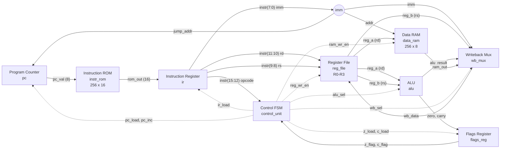
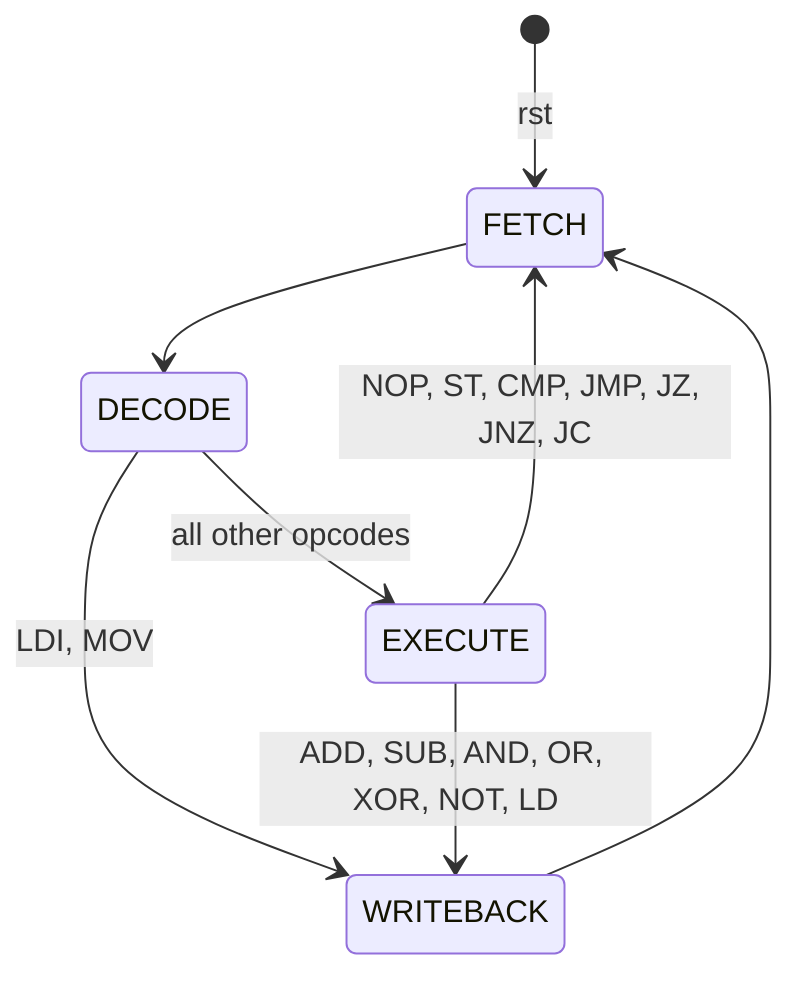
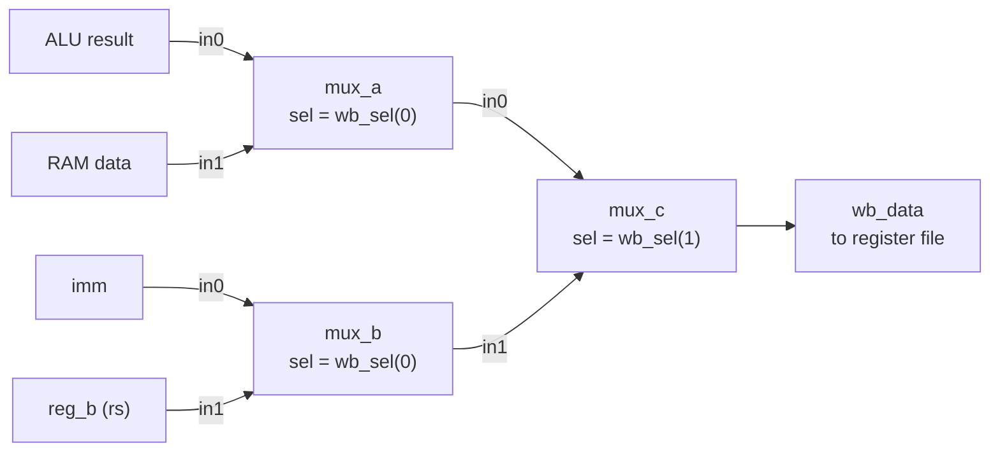
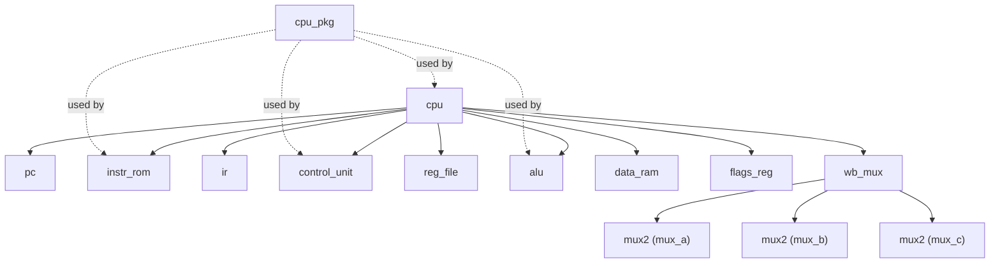

# 8-bit CPU in VHDL — Multi-cycle version

A simple 8-bit, **multi-cycle**, Harvard-architecture CPU written in VHDL and
verified with self-checking testbenches in the Vivado behavioral simulator (XSIM).

This branch converts the single-cycle CPU on `main` into a multi-cycle design.
An instruction register holds each instruction while a finite-state-machine
(FSM) control unit steps it through FETCH, DECODE, EXECUTE and WRITEBACK, taking
3 or 4 clocks per instruction. The instruction set, the program and every
datapath component except the control unit are unchanged.

**Status:** RTL complete. All 11 testbenches pass.

> **Branches**
>
> | Branch | Version | Status |
> |---|---|---|
> | `main` | Single-cycle CPU (tag `v1.0-single-cycle`) | Complete and verified |
> | `multicycle` | Multi-cycle CPU with an FSM control unit | Complete and verified (this branch) |

---

## Table of contents

- [Features](#features)
- [Single-cycle vs multi-cycle](#single-cycle-vs-multi-cycle)
- [Architecture](#architecture)
  - [Design decisions](#design-decisions)
  - [Datapath](#datapath)
  - [Control FSM](#control-fsm)
  - [Cycles per instruction](#cycles-per-instruction)
  - [Writeback multiplexer](#writeback-multiplexer)
- [Instruction set](#instruction-set)
- [Control unit](#control-unit)
- [Components](#components)
- [Project structure](#project-structure)
- [Running the simulation](#running-the-simulation)
- [Verification](#verification)
- [Writing your own program](#writing-your-own-program)
- [Limitations](#limitations)
- [Future work](#future-work)

---

## Features

- 8-bit data path, 8-bit program counter (256 instruction addresses)
- 16-bit instruction word, 16 instructions
- Harvard architecture: separate 256 x 16 instruction ROM and 256 x 8 data RAM
- Four 8-bit general-purpose registers (R0-R3)
- Zero (Z) and Carry (C) flags with independent load enables
- **Multi-cycle execution:** 3 or 4 clocks per instruction, driven by a 4-state FSM
- 16-bit instruction register (IR) holding the instruction for the whole sequence
- Synchronous reset
- Point-to-point datapath with multiplexers (no tri-state bus)
- Self-checking testbenches for every component, plus a full-system testbench that checks the FSM state on every cycle

---

## Single-cycle vs multi-cycle

| | Single-cycle (`main`) | Multi-cycle (this branch) |
|---|---|---|
| Clocks per instruction | 1 | 3 or 4 |
| Control unit | Combinational `case` on the opcode | FSM: state register + next-state logic + output logic |
| Instruction register | None (ROM output used directly) | 16-bit IR, loaded in FETCH |
| When things are written | Everything on the same edge | Each write only in its own state |
| `pc_inc` | Always 1 | 1 only in FETCH |
| Test program, reset to halt | 16 cycles | 56 cycles |
| Debug outputs | `pc`, `instr`, `reg_a`, `z`, `c` | Same, plus `state_dbg` |

The multi-cycle design is slower per instruction in clock count, but each
clock does less work, so the critical path is shorter. It is also the starting
point for designs with synchronous memories or a shared instruction/data memory.

---

## Architecture

### Design decisions

| Topic | Decision | Reason |
|---|---|---|
| Memory model | Harvard: separate instruction ROM and data RAM | Fetch and data access never collide. A program cannot overwrite its own code |
| Interconnect | Point-to-point wiring plus a writeback multiplexer | FPGA fabric has no internal tri-state buses; multiplexers avoid conflicting drivers |
| Data width | 8 bits | Registers, ALU and RAM are all 8 bits wide |
| Instruction width | 16 bits | An 8-bit word cannot hold an opcode plus an 8-bit constant or address |
| Registers | 4 x 8-bit (R0-R3) | Fits a 2-bit register field, leaving 8 bits for an immediate |
| Control | Multi-cycle FSM, 4 states | Each instruction uses only the states it needs (3 or 4) |
| Holding registers | IR only | Registers change only in WRITEBACK, so ALU inputs and result stay stable from DECODE to WRITEBACK without A/B/ALUOut registers |
| Selects vs enables | Selects (`alu_sel`, `wb_sel`) from the opcode only; enables from the state | Selects choose *what*; enables decide *when*. Keeps the output logic simple |
| Reset | Synchronous, highest priority | PC, IR, register file, flags register and FSM (back to FETCH). The data RAM has no reset |
| Flags | Zero and Carry only | Enough for JZ, JNZ and JC |
| Carry on SUB | Borrow convention: C = 1 when a < b | `JC` after `CMP a, b` means "jump if a < b" (unsigned) |

### Datapath



Solid arrows are data; dotted arrows are control signals from the FSM.

The only datapath change from `main` is the IR between the ROM and the
instruction fields. Every `instr(...)` slice now comes from the IR, so the
instruction stays stable while the FSM steps through its states, even though
the PC has already moved on to the next address.

### Control FSM



| State | Work done | Enables active |
|---|---|---|
| FETCH | IR loads `ROM[PC]`; PC increments | `ir_load`, `pc_inc` |
| DECODE | Opcode stable in the IR; register reads settle; next state chosen from the opcode | none |
| EXECUTE | ALU result settles; flags load; ST writes RAM; jumps load the PC | `z_load`, `c_load`, `ram_wr_en`, `pc_load` (per opcode) |
| WRITEBACK | Result written to rd | `reg_wr_en` |

Why it works without extra holding registers:

- **PC+1 happens in FETCH, a jump loads in EXECUTE.** They never collide; a taken jump overwrites the already-incremented PC.
- **The register file only changes in WRITEBACK.** ALU inputs, and therefore its result, are stable from DECODE through WRITEBACK.
- **Flags load in EXECUTE.** They are stable by the time any later jump reads them.

### Cycles per instruction

| Instructions | Path | Clocks |
|---|---|---|
| NOP, ST, CMP, JMP, JZ, JNZ, JC | FETCH → DECODE → EXECUTE | 3 |
| LDI, MOV | FETCH → DECODE → WRITEBACK | 3 |
| ADD, SUB, AND, OR, XOR, NOT, LD | FETCH → DECODE → EXECUTE → WRITEBACK | 4 |

### Writeback multiplexer

`wb_mux` is a 4-to-1 multiplexer built from three 2-to-1 multiplexers (`mux2`):



| wb_sel | Constant | Source | Used by |
|---|---|---|---|
| 00 | `WB_ALU` | ALU result | ADD, SUB, AND, OR, XOR, NOT |
| 01 | `WB_RAM` | Data RAM | LD |
| 10 | `WB_IMM` | Immediate | LDI |
| 11 | `WB_REG` | rs register | MOV |

---

## Instruction set

Unchanged from `main`.

### Instruction format

```
 15    12 11  10 9    8 7                 0
+--------+------+------+-------------------+
| opcode |  rd  |  rs  |        imm        |
+--------+------+------+-------------------+
  4 bits  2 bits 2 bits       8 bits
```

Unused fields are 0. In hexadecimal: digit 1 is the opcode, digit 2 is `4 x rd + rs`, digits 3-4 are imm.

### Instructions

| Hex | Mnemonic | Operation | Flags |
|---|---|---|---|
| 0 | `NOP` | No operation | - |
| 1 | `LDI rd, imm` | rd = imm | - |
| 2 | `MOV rd, rs` | rd = rs | - |
| 3 | `LD rd, addr` | rd = RAM[addr] | - |
| 4 | `ST rd, addr` | RAM[addr] = rd | - |
| 5 | `ADD rd, rs` | rd = rd + rs | Z, C |
| 6 | `SUB rd, rs` | rd = rd - rs | Z, C |
| 7 | `AND rd, rs` | rd = rd and rs | Z |
| 8 | `OR rd, rs` | rd = rd or rs | Z |
| 9 | `XOR rd, rs` | rd = rd xor rs | Z |
| A | `NOT rd` | rd = not rd | Z |
| B | `CMP rd, rs` | Compute rd - rs, set flags, discard result | Z, C |
| C | `JMP addr` | PC = addr | - |
| D | `JZ addr` | PC = addr if Z = 1 | - |
| E | `JNZ addr` | PC = addr if Z = 0 | - |
| F | `JC addr` | PC = addr if C = 1 | - |

`JMP` to its own address acts as a halt (the FSM keeps cycling FETCH, DECODE, EXECUTE on it).

### Flags

| Flag | Set when | Updated by | Read by |
|---|---|---|---|
| Z (zero) | ALU result is 00 | ADD, SUB, CMP, AND, OR, XOR, NOT | JZ, JNZ |
| C (carry) | ADD: overflow past FF. SUB/CMP: borrow (rd < rs) | ADD, SUB, CMP only | JC |

Logic operations update Z but keep C, so the flags register has a separate load enable per flag.

---

## Control unit

`control_unit.vhd` is a three-process FSM:

| Process | Type | Contents |
|---|---|---|
| `state_reg` | Clocked | Synchronous reset to FETCH, otherwise `state <= next_state` |
| `next_state_logic` | Combinational | Transition table below |
| `output_logic` | Combinational | Defaults, then selects from the opcode, then enables from the state |

The state type `state_t` is declared in `cpu_pkg`, so it can appear on ports and the waveform shows state names.

### Next state

| Current | Condition | Next |
|---|---|---|
| FETCH | always | DECODE |
| DECODE | LDI, MOV | WRITEBACK |
| DECODE | otherwise | EXECUTE |
| EXECUTE | ADD, SUB, AND, OR, XOR, NOT, LD | WRITEBACK |
| EXECUTE | otherwise | FETCH |
| WRITEBACK | always | FETCH |

### Selects (from the opcode, in every state)

| Opcode | alu_sel | wb_sel |
|---|---|---|
| ADD | ADD | ALU |
| SUB, CMP | SUB | ALU |
| AND / OR / XOR / NOT | AND / OR / XOR / NOT | ALU |
| LDI | ADD | IMM |
| MOV | ADD | REG |
| LD | ADD | RAM |
| others | ADD | ALU |

### Enables (by state)

| State | Opcode | Enables = 1 |
|---|---|---|
| FETCH | any | `ir_load`, `pc_inc` |
| DECODE | any | none |
| EXECUTE | ADD, SUB, CMP | `z_load`, `c_load` |
| EXECUTE | AND, OR, XOR, NOT | `z_load` |
| EXECUTE | ST | `ram_wr_en` |
| EXECUTE | JMP | `pc_load` |
| EXECUTE | JZ / JNZ / JC | `pc_load` = Z / not Z / C |
| EXECUTE | NOP, LD | none |
| WRITEBACK | any | `reg_wr_en` |

---

## Components

| Entity | File | Type | Description |
|---|---|---|---|
| `cpu_pkg` | `cpu_pkg.vhd` | Package | `OP_*`, `ALU_*`, `REG0`-`REG3`, `WB_*` constants and the FSM state type `state_t` |
| `cpu` | `cpu.vhd` | Structural | Top level; instantiates and wires every component. Exposes debug outputs |
| `pc` | `pc.vhd` | Sequential | 8-bit program counter. Priority: reset > load > increment > hold |
| `instr_rom` | `instr_rom.vhd` | Combinational | 256 x 16 instruction ROM, asynchronous read |
| `ir` | `ir.vhd` | Sequential | **New.** 16-bit instruction register, loaded in FETCH |
| `control_unit` | `control_unit.vhd` | Sequential (FSM) | **Rewritten.** 4-state control FSM |
| `reg_file` | `reg_file.vhd` | Sequential | 4 x 8-bit registers, two asynchronous read ports, one synchronous write port |
| `alu` | `alu.vhd` | Combinational | ADD, SUB, AND, OR, XOR, NOT with zero and carry outputs |
| `flags_reg` | `flags_reg.vhd` | Sequential | Stores Z and C with independent load enables |
| `data_ram` | `data_ram.vhd` | Sequential | 256 x 8 data RAM, synchronous write, asynchronous read, no reset |
| `wb_mux` | `wb_mux.vhd` | Structural | 4-to-1 writeback multiplexer built from three `mux2` |
| `mux2` | `mux2.vhd` | Combinational | 8-bit 2-to-1 multiplexer (gate-level) |

### Component hierarchy



### Debug outputs

| Port | Width | Shows |
|---|---|---|
| `pc_dbg` | 8 | Program counter (already the next address after FETCH) |
| `instr_dbg` | 16 | Instruction register |
| `reg_a_dbg` | 8 | Value of the rd register of the instruction in the IR |
| `z_dbg` | 1 | Stored zero flag |
| `c_dbg` | 1 | Stored carry flag |
| `state_dbg` | `state_t` | Current FSM state |

---

## Project structure

```
8-bit-cpu/
├── rtl/
│   ├── cpu_pkg.vhd
│   ├── cpu.vhd
│   ├── pc.vhd
│   ├── instr_rom.vhd
│   ├── ir.vhd
│   ├── control_unit.vhd
│   ├── reg_file.vhd
│   ├── alu.vhd
│   ├── flags_reg.vhd
│   ├── data_ram.vhd
│   ├── wb_mux.vhd
│   └── mux2.vhd
├── tb/
│   ├── tb_cpu.vhd
│   ├── tb_pc.vhd
│   ├── tb_instr_rom.vhd
│   ├── tb_ir.vhd
│   ├── tb_control_unit.vhd
│   ├── tb_reg_file.vhd
│   ├── tb_alu.vhd
│   ├── tb_flags_reg.vhd
│   ├── tb_data_ram.vhd
│   ├── tb_wb_mux.vhd
│   └── tb_mux2.vhd
└── README.md
```

### Coding conventions

- `std_logic_vector` at ports, `numeric_std` for arithmetic
- Architectures named `rtl` (behavioural), `structural` (instantiation only) or `sim` (testbenches)
- Synchronous active-high reset
- Instances prefixed `u_` in the top level
- Every combinational process assigns defaults before any branching, so no latches are inferred
- FSM states as an enumerated type, so waveforms and failure messages show state names

---

## Running the simulation

1. Create a new RTL project in Vivado.
2. **Add design sources:** every file in `rtl/`.
3. **Add simulation sources:** every file in `tb/`.
4. **Compile order:** `cpu_pkg.vhd` must compile first (it is used by `alu`, `control_unit`, `instr_rom`, `cpu` and several testbenches). Right-click in Sources → **Hierarchy Update** → **Automatic Update and Compile Order**, then check the **Compile Order** tab.
5. Right-click the testbench to run → **Set as Top**.
6. **Run Simulation** → **Run Behavioral Simulation**.
7. Check the Tcl Console for `Note: all tests completed and passed`.

A failing run stops at the first failed check, naming the test and signal, for example:

```
Failure: cycle 28 failed: pc_dbg
Failure: test 8 AND execute failed: z_load
Failure: test 4 LD writeback failed: state is S_FETCH
```

---

## Verification

Every testbench is self-checking (`assert ... severity failure`). The clocked FSM and system testbenches use a `check` procedure so each cycle is one line that compares every output.

### Testbenches

| Testbench | Checks | What is covered | Passes at |
|---|---|---|---|
| `tb_mux2` | 10 | Both select values over several bit patterns | 100 ns |
| `tb_wb_mux` | 6 | All four writeback paths | 60 ns |
| `tb_alu` | 20 | Every operation, carry/borrow edge cases, spare codes | 200 ns |
| `tb_instr_rom` | 7 | Program words against hand-encoded hex | 70 ns |
| `tb_data_ram` | 9 | Writes, top address, blocked write, write timing | 90 ns |
| `tb_pc` | 11 | Reset, increment, hold, load priority, wrap | 120 ns |
| `tb_ir` | 8 | Reset, load, hold, full 16-bit width, reset priority, load timing | 80 ns |
| `tb_flags_reg` | 9 | Independent flag loads, hold, reset priority, timing | 90 ns |
| `tb_reg_file` | 14 | Every register, both ports, reset priority, timing | 140 ns |
| `tb_control_unit` | 68 | Every opcode through its full state sequence; each conditional jump both ways; reset mid-instruction | 680 ns |
| `tb_cpu` | 64 cycles | Full program, FSM state and all debug outputs every cycle | 640 ns |

In `tb_control_unit` the opcode changes only during FETCH, exactly as the IR would load it, so EXECUTE-to-next transitions are never tested with the wrong opcode.

### System test program

| Addr | Instruction | Hex | Effect |
|---|---|---|---|
| 0 | `LDI R0, 0F` | `100F` | R0 = 0F |
| 1 | `LDI R1, 3C` | `143C` | R1 = 3C |
| 2 | `MOV R2, R1` | `2900` | R2 = 3C |
| 3 | `ADD R2, R0` | `5800` | R2 = 4B |
| 4 | `AND R2, R1` | `7900` | R2 = 08 |
| 5 | `OR R2, R0` | `8800` | R2 = 0F |
| 6 | `XOR R2, R0` | `9800` | R2 = 00, Z = 1 |
| 7 | `JZ 09` | `D009` | Taken |
| 8 | `LDI R3, FF` | `1CFF` | Must be skipped |
| 9 | `NOT R2` | `A800` | R2 = FF |
| 10 | `ST R2, 20` | `4820` | RAM[20] = FF |
| 11 | `LD R3, 20` | `3C20` | R3 = FF |
| 12 | `SUB R0, R1` | `6100` | R0 = D3, C = 1 (borrow) |
| 13 | `JC 0F` | `F00F` | Taken |
| 14 | `LDI R3, 00` | `1C00` | Must be skipped |
| 15 | `CMP R3, R2` | `BE00` | Z = 1, C = 0, R3 unchanged |
| 16 | `JNZ 12` | `E012` | Not taken |
| 17 | `NOP` | `0000` | |
| 18 | `JMP 12` | `C012` | Halt |

### Expected trace

Checked by `tb_cpu` at each falling edge. Values are hexadecimal.

How to read it:
- **PC runs one ahead after FETCH**: it increments in FETCH, so DECODE onwards shows the next address.
- **IR changes only at the end of FETCH**; cycle 0 shows `0000` from reset.
- **Results appear one state later**: a WRITEBACK's value is visible at the next FETCH; flags loaded in EXECUTE are visible from the next state.
- **The halt** cycles FETCH, DECODE, EXECUTE on `JMP 12`, so the PC alternates 12, 13, 13.

| Cycle | State | PC | IR | Instruction in IR | reg_a | Z | C |
|---|---|---|---|---|---|---|---|
| 0 | FETCH | 00 | `0000` | (reset) | 00 | 0 | 0 |
| 1 | DECODE | 01 | `100F` | LDI R0, 0F | 00 | 0 | 0 |
| 2 | WRITEBACK | 01 | `100F` | LDI R0, 0F | 00 | 0 | 0 |
| 3 | FETCH | 01 | `100F` | LDI R0, 0F | 0F | 0 | 0 |
| 4 | DECODE | 02 | `143C` | LDI R1, 3C | 00 | 0 | 0 |
| 5 | WRITEBACK | 02 | `143C` | LDI R1, 3C | 00 | 0 | 0 |
| 6 | FETCH | 02 | `143C` | LDI R1, 3C | 3C | 0 | 0 |
| 7 | DECODE | 03 | `2900` | MOV R2, R1 | 00 | 0 | 0 |
| 8 | WRITEBACK | 03 | `2900` | MOV R2, R1 | 00 | 0 | 0 |
| 9 | FETCH | 03 | `2900` | MOV R2, R1 | 3C | 0 | 0 |
| 10 | DECODE | 04 | `5800` | ADD R2, R0 | 3C | 0 | 0 |
| 11 | EXECUTE | 04 | `5800` | ADD R2, R0 | 3C | 0 | 0 |
| 12 | WRITEBACK | 04 | `5800` | ADD R2, R0 | 3C | 0 | 0 |
| 13 | FETCH | 04 | `5800` | ADD R2, R0 | 4B | 0 | 0 |
| 14 | DECODE | 05 | `7900` | AND R2, R1 | 4B | 0 | 0 |
| 15 | EXECUTE | 05 | `7900` | AND R2, R1 | 4B | 0 | 0 |
| 16 | WRITEBACK | 05 | `7900` | AND R2, R1 | 4B | 0 | 0 |
| 17 | FETCH | 05 | `7900` | AND R2, R1 | 08 | 0 | 0 |
| 18 | DECODE | 06 | `8800` | OR R2, R0 | 08 | 0 | 0 |
| 19 | EXECUTE | 06 | `8800` | OR R2, R0 | 08 | 0 | 0 |
| 20 | WRITEBACK | 06 | `8800` | OR R2, R0 | 08 | 0 | 0 |
| 21 | FETCH | 06 | `8800` | OR R2, R0 | 0F | 0 | 0 |
| 22 | DECODE | 07 | `9800` | XOR R2, R0 | 0F | 0 | 0 |
| 23 | EXECUTE | 07 | `9800` | XOR R2, R0 | 0F | 0 | 0 |
| 24 | WRITEBACK | 07 | `9800` | XOR R2, R0 | 0F | 1 | 0 |
| 25 | FETCH | 07 | `9800` | XOR R2, R0 | 00 | 1 | 0 |
| 26 | DECODE | 08 | `D009` | JZ 09 | 0F | 1 | 0 |
| 27 | EXECUTE | 08 | `D009` | JZ 09 | 0F | 1 | 0 |
| 28 | FETCH | 09 | `D009` | JZ 09 | 0F | 1 | 0 |
| 29 | DECODE | 0A | `A800` | NOT R2 | 00 | 1 | 0 |
| 30 | EXECUTE | 0A | `A800` | NOT R2 | 00 | 1 | 0 |
| 31 | WRITEBACK | 0A | `A800` | NOT R2 | 00 | 0 | 0 |
| 32 | FETCH | 0A | `A800` | NOT R2 | FF | 0 | 0 |
| 33 | DECODE | 0B | `4820` | ST R2, 20 | FF | 0 | 0 |
| 34 | EXECUTE | 0B | `4820` | ST R2, 20 | FF | 0 | 0 |
| 35 | FETCH | 0B | `4820` | ST R2, 20 | FF | 0 | 0 |
| 36 | DECODE | 0C | `3C20` | LD R3, 20 | 00 | 0 | 0 |
| 37 | EXECUTE | 0C | `3C20` | LD R3, 20 | 00 | 0 | 0 |
| 38 | WRITEBACK | 0C | `3C20` | LD R3, 20 | 00 | 0 | 0 |
| 39 | FETCH | 0C | `3C20` | LD R3, 20 | FF | 0 | 0 |
| 40 | DECODE | 0D | `6100` | SUB R0, R1 | 0F | 0 | 0 |
| 41 | EXECUTE | 0D | `6100` | SUB R0, R1 | 0F | 0 | 0 |
| 42 | WRITEBACK | 0D | `6100` | SUB R0, R1 | 0F | 0 | 1 |
| 43 | FETCH | 0D | `6100` | SUB R0, R1 | D3 | 0 | 1 |
| 44 | DECODE | 0E | `F00F` | JC 0F | D3 | 0 | 1 |
| 45 | EXECUTE | 0E | `F00F` | JC 0F | D3 | 0 | 1 |
| 46 | FETCH | 0F | `F00F` | JC 0F | D3 | 0 | 1 |
| 47 | DECODE | 10 | `BE00` | CMP R3, R2 | FF | 0 | 1 |
| 48 | EXECUTE | 10 | `BE00` | CMP R3, R2 | FF | 0 | 1 |
| 49 | FETCH | 10 | `BE00` | CMP R3, R2 | FF | 1 | 0 |
| 50 | DECODE | 11 | `E012` | JNZ 12 | D3 | 1 | 0 |
| 51 | EXECUTE | 11 | `E012` | JNZ 12 | D3 | 1 | 0 |
| 52 | FETCH | 11 | `E012` | JNZ 12 | D3 | 1 | 0 |
| 53 | DECODE | 12 | `0000` | NOP | D3 | 1 | 0 |
| 54 | EXECUTE | 12 | `0000` | NOP | D3 | 1 | 0 |
| 55 | FETCH | 12 | `0000` | NOP | D3 | 1 | 0 |
| 56 | DECODE | 13 | `C012` | JMP 12 | D3 | 1 | 0 |
| 57 | EXECUTE | 13 | `C012` | JMP 12 | D3 | 1 | 0 |
| 58 | FETCH | 12 | `C012` | JMP 12 | D3 | 1 | 0 |
| 59 | DECODE | 13 | `C012` | JMP 12 | D3 | 1 | 0 |
| 60 | EXECUTE | 13 | `C012` | JMP 12 | D3 | 1 | 0 |
| 61 | FETCH | 12 | `C012` | JMP 12 | D3 | 1 | 0 |
| 62 | DECODE | 13 | `C012` | JMP 12 | D3 | 1 | 0 |
| 63 | EXECUTE | 13 | `C012` | JMP 12 | D3 | 1 | 0 |

Key checks: register results at the FETCH after each WRITEBACK (cycles 3, 6, 9, 13...), the jumps landing at 09 (cycle 28) and 0F (cycle 46), R3 still 00 at cycle 36 (the skipped LDI never ran) and FF at cycle 47 (LD worked), JNZ falling through to 11 (cycle 52), and the halt loop from cycle 56.

---

## Writing your own program

Programs live in the `rom_data` constant in `instr_rom.vhd`, built from `cpu_pkg` constants as `opcode & rd & rs & imm`:

```vhdl
constant rom_data : rom_type := (
    0 => OP_LDI & REG0 & REG0 & x"03",   -- LDI R0, 03   counter
    1 => OP_LDI & REG1 & REG0 & x"01",   -- LDI R1, 01   step
    2 => OP_SUB & REG0 & REG1 & x"00",   -- SUB R0, R1
    3 => OP_JNZ & REG0 & REG0 & x"02",   -- JNZ 02       loop until R0 = 0
    4 => OP_JMP & REG0 & REG0 & x"04",   -- JMP 04       halt
    others => x"0000"
);
```

- Put `REG0` and `x"00"` in unused fields.
- Jump targets in `imm` are hexadecimal; array indices on the left are decimal.
- End with a `JMP` to its own address.
- After changing the program, update `tb_instr_rom.vhd` and the expected trace in `tb_cpu.vhd`. Remember each instruction now takes 3 or 4 cycles.

---

## Limitations

- No stack, subroutine calls or interrupts.
- No shift, rotate, increment or decrement instructions.
- Only direct addressing for LD/ST.
- Unsigned arithmetic only: no overflow or negative flag.
- The program is fixed in `instr_rom.vhd`.
- Memories still read asynchronously. FPGA block RAM reads are synchronous; supporting them needs an extra state or holding registers.

---

## Future work

- **Synchronous memories** (block-RAM style), with A/B/ALUOut holding registers.
- **Shared instruction/data memory** (von Neumann), which the multi-cycle structure makes possible.
- **Load the ROM from a text file** at simulation start.
- **Shift and INC/DEC instructions**, using the spare ALU codes `110` and `111`.
- **Stack pointer** with PUSH, POP, CALL and RET.
