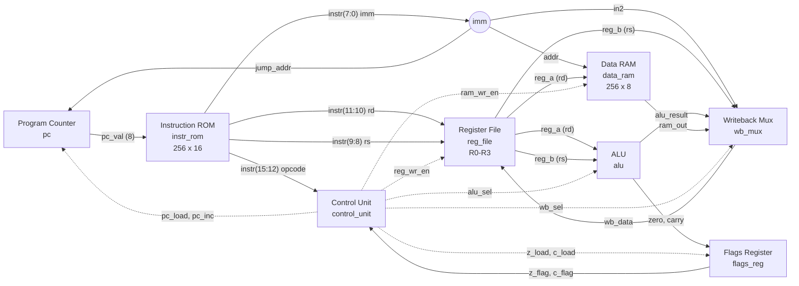
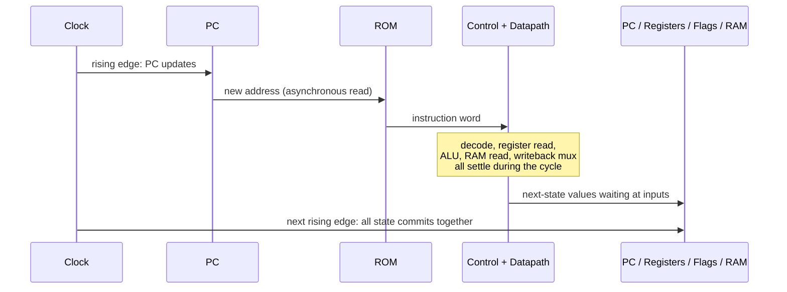
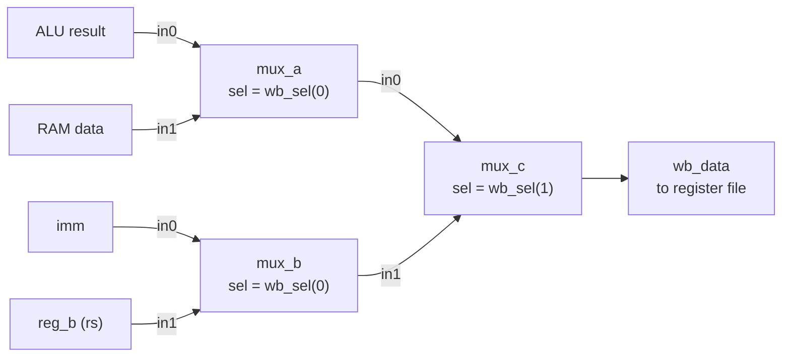
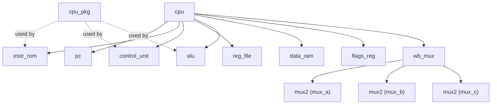
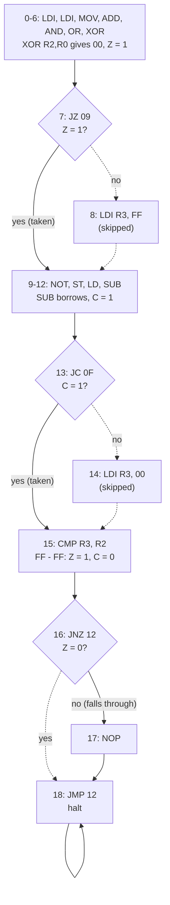

# 8-bit CPU in VHDL

A simple 8-bit, single-cycle, Harvard-architecture CPU written in VHDL and verified
with self-checking testbenches in the Vivado behavioral simulator (XSIM).

The CPU has a 16-bit instruction word, four general-purpose registers, Zero and
Carry flags, and a 16-instruction set covering load/store, arithmetic, logic,
compare and conditional jumps. Every component has its own testbench, and a
system testbench runs a program that uses all 16 instructions and checks the
CPU state on every clock cycle.

**Status:** RTL complete. All 10 testbenches pass.

> **Branches**
>
> | Branch | Version | Status |
> |---|---|---|
> | `main` | Single-cycle CPU (tag `v1.0-single-cycle`) | Complete and verified |
> | `multicycle` | Multi-cycle CPU with an FSM control unit | Complete and verified |
>
> This README describes the single-cycle version on `main`. The `multicycle` branch has its own README covering the FSM, cycle counts and its testbenches.

---

## Table of contents

- [Features](#features)
- [Architecture](#architecture)
  - [Design decisions](#design-decisions)
  - [Datapath](#datapath)
  - [Single-cycle execution](#single-cycle-execution)
  - [Writeback multiplexer](#writeback-multiplexer)
- [Instruction set](#instruction-set)
  - [Instruction format](#instruction-format)
  - [Instructions](#instructions)
  - [Encoding examples](#encoding-examples)
  - [Flags](#flags)
- [Control unit](#control-unit)
- [Components](#components)
- [Project structure](#project-structure)
- [Running the simulation](#running-the-simulation)
- [Verification](#verification)
  - [Component testbenches](#component-testbenches)
  - [System test program](#system-test-program)
  - [Expected trace](#expected-trace)
- [Writing your own program](#writing-your-own-program)
- [Limitations](#limitations)
- [Future work](#future-work)

---

## Features

- 8-bit data path, 8-bit program counter (256 instruction addresses)
- 16-bit instruction word, 16 instructions
- Harvard architecture: separate 256 x 16 instruction ROM and 256 x 8 data RAM
- Four 8-bit general-purpose registers (R0-R3)
- Zero (Z) and Carry (C) flags with independent load enables
- Single-cycle execution: one instruction per clock
- Synchronous reset
- Fully point-to-point datapath with multiplexers (no tri-state bus)
- Self-checking testbenches for every component, plus a full-system testbench

---

## Architecture

### Design decisions

| Topic | Decision | Reason |
|---|---|---|
| Memory model | Harvard: separate instruction ROM and data RAM | Fetch and data access never collide, so every instruction fits in one cycle. A program cannot overwrite its own code |
| Interconnect | Point-to-point wiring plus a writeback multiplexer | FPGA fabric has no internal tri-state buses; multiplexers avoid conflicting drivers |
| Data width | 8 bits | It is an 8-bit CPU: registers, ALU and RAM are all 8 bits wide |
| Instruction width | 16 bits | An 8-bit word cannot hold an opcode plus an 8-bit constant or address. Harvard lets the ROM be wider than the data |
| Registers | 4 x 8-bit (R0-R3) | Fits a 2-bit register field, leaving 8 bits for an immediate |
| Control | Single-cycle | Memory reads are asynchronous, so fetch, decode, execute and writeback all settle within one clock |
| Reset | Synchronous, highest priority | Used by the PC, register file and flags register. The data RAM has no reset |
| Flags | Zero and Carry only | Enough for JZ, JNZ and JC |
| Carry on SUB | Borrow convention: C = 1 when a < b | `JC` after `CMP a, b` means "jump if a < b" (unsigned) |

### Datapath



Solid arrows are data; dotted arrows are control signals from the control unit.

How the instruction fields are routed:

| Field | Bits | Goes to |
|---|---|---|
| opcode | 15:12 | Control unit |
| rd | 11:10 | Register file read port A **and** write select (rd is both a source and the destination) |
| rs | 9:8 | Register file read port B |
| imm | 7:0 | PC jump address, data RAM address, writeback mux (immediate value) |

The same `imm` bits always reach all three destinations; the control signals decide which one actually uses them.

### Single-cycle execution

Every instruction takes exactly one clock period:



1. After a rising edge, the new PC value addresses the ROM.
2. The instruction word, control signals, register reads, ALU result, RAM read and writeback value all settle combinationally.
3. On the next rising edge the PC, register file, flags register and data RAM update at the same time.

Because there is no instruction register, a waveform reads like the program: each clock period is one instruction.

### Writeback multiplexer

The register file can be written from four sources. `wb_mux` is a 4-to-1 multiplexer built from three 2-to-1 multiplexers (`mux2`):



Bit 0 picks within each pair; bit 1 picks the pair.

| wb_sel | Constant | Source | Used by |
|---|---|---|---|
| 00 | `WB_ALU` | ALU result | ADD, SUB, AND, OR, XOR, NOT |
| 01 | `WB_RAM` | Data RAM | LD |
| 10 | `WB_IMM` | Immediate | LDI |
| 11 | `WB_REG` | rs register | MOV |

---

## Instruction set

### Instruction format

```
 15    12 11  10 9    8 7                 0
+--------+------+------+-------------------+
| opcode |  rd  |  rs  |        imm        |
+--------+------+------+-------------------+
  4 bits  2 bits 2 bits       8 bits
```

Unused fields are 0. In hexadecimal the word reads naturally:

| Hex digit | 1 | 2 | 3 and 4 |
|---|---|---|---|
| Meaning | opcode | 4 x rd + rs | imm |

Digit 2 lookup:

| | rs = R0 | rs = R1 | rs = R2 | rs = R3 |
|---|---|---|---|---|
| **rd = R0** | 0 | 1 | 2 | 3 |
| **rd = R1** | 4 | 5 | 6 | 7 |
| **rd = R2** | 8 | 9 | A | B |
| **rd = R3** | C | D | E | F |

### Instructions

| Hex | Mnemonic | Operation | Flags |
|---|---|---|---|
| 0 | `NOP` | No operation | - |
| 1 | `LDI rd, imm` | rd = imm | - |
| 2 | `MOV rd, rs` | rd = rs | - |
| 3 | `LD rd, addr` | rd = RAM[addr] | - |
| 4 | `ST rd, addr` | RAM[addr] = rd | - |
| 5 | `ADD rd, rs` | rd = rd + rs | Z, C |
| 6 | `SUB rd, rs` | rd = rd - rs | Z, C |
| 7 | `AND rd, rs` | rd = rd and rs | Z |
| 8 | `OR rd, rs` | rd = rd or rs | Z |
| 9 | `XOR rd, rs` | rd = rd xor rs | Z |
| A | `NOT rd` | rd = not rd | Z |
| B | `CMP rd, rs` | Compute rd - rs, set flags, discard result | Z, C |
| C | `JMP addr` | PC = addr | - |
| D | `JZ addr` | PC = addr if Z = 1 | - |
| E | `JNZ addr` | PC = addr if Z = 0 | - |
| F | `JC addr` | PC = addr if C = 1 | - |

An all-zero ROM is a valid program (all NOPs). `JMP` to its own address acts as a halt.

### Encoding examples

| Instruction | Fields (opcode rd rs imm) | Hex |
|---|---|---|
| `LDI R1, 05` | 0001 01 00 00000101 | `1405` |
| `MOV R2, R1` | 0010 10 01 00000000 | `2900` |
| `ADD R1, R2` | 0101 01 10 00000000 | `5600` |
| `SUB R0, R1` | 0110 00 01 00000000 | `6100` |
| `ST R2, 20` | 0100 10 00 00100000 | `4820` |
| `JNZ 02` | 1110 00 00 00000010 | `E002` |
| `JMP 12` | 1100 00 00 00010010 | `C012` |

### Flags

| Flag | Set when | Updated by | Read by |
|---|---|---|---|
| Z (zero) | ALU result is 00 | ADD, SUB, CMP, AND, OR, XOR, NOT | JZ, JNZ |
| C (carry) | ADD: result overflowed past FF. SUB/CMP: borrow (rd < rs) | ADD, SUB, CMP only | JC |

Logic operations update Z but **keep** C: the ALU outputs carry = 0 for logic operations, so the flags register has a separate load enable for each flag. Instructions that do not affect flags leave both unchanged, so a conditional jump can test the result of an instruction several steps earlier.

---

## Control unit

The control unit is purely combinational: a block of defaults (NOP behaviour) followed by one `case` on the opcode. Each branch overrides only what differs from the defaults.

| Opcode | reg_wr_en | wb_sel | alu_sel | ram_wr_en | z_load | c_load | pc_load |
|---|---|---|---|---|---|---|---|
| NOP | 0 | ALU | ADD | 0 | 0 | 0 | 0 |
| LDI | **1** | **IMM** | ADD | 0 | 0 | 0 | 0 |
| MOV | **1** | **REG** | ADD | 0 | 0 | 0 | 0 |
| LD | **1** | **RAM** | ADD | 0 | 0 | 0 | 0 |
| ST | 0 | ALU | ADD | **1** | 0 | 0 | 0 |
| ADD | **1** | ALU | ADD | 0 | **1** | **1** | 0 |
| SUB | **1** | ALU | **SUB** | 0 | **1** | **1** | 0 |
| AND | **1** | ALU | **AND** | 0 | **1** | 0 | 0 |
| OR | **1** | ALU | **OR** | 0 | **1** | 0 | 0 |
| XOR | **1** | ALU | **XOR** | 0 | **1** | 0 | 0 |
| NOT | **1** | ALU | **NOT** | 0 | **1** | 0 | 0 |
| CMP | 0 | ALU | **SUB** | 0 | **1** | **1** | 0 |
| JMP | 0 | ALU | ADD | 0 | 0 | 0 | **1** |
| JZ | 0 | ALU | ADD | 0 | 0 | 0 | **Z** |
| JNZ | 0 | ALU | ADD | 0 | 0 | 0 | **not Z** |
| JC | 0 | ALU | ADD | 0 | 0 | 0 | **C** |

`pc_inc` is always 1. The PC gives `pc_load` priority over increment, so a taken jump overrides it automatically.

---

## Components

| Entity | File | Type | Description |
|---|---|---|---|
| `cpu_pkg` | `cpu_pkg.vhd` | Package | Opcode (`OP_*`), ALU (`ALU_*`), register (`REG0`-`REG3`) and writeback-select (`WB_*`) constants |
| `cpu` | `cpu.vhd` | Structural | Top level; instantiates and wires every component. Exposes debug outputs |
| `pc` | `pc.vhd` | Sequential | 8-bit program counter. Priority: reset > load > increment > hold. Wraps FF to 00 |
| `instr_rom` | `instr_rom.vhd` | Combinational | 256 x 16 instruction ROM, asynchronous read. Holds the program |
| `control_unit` | `control_unit.vhd` | Combinational | Opcode and flags to control signals |
| `reg_file` | `reg_file.vhd` | Sequential | 4 x 8-bit registers, two asynchronous read ports, one synchronous write port |
| `alu` | `alu.vhd` | Combinational | ADD, SUB, AND, OR, XOR, NOT with zero and carry outputs |
| `flags_reg` | `flags_reg.vhd` | Sequential | Stores Z and C with independent load enables |
| `data_ram` | `data_ram.vhd` | Sequential | 256 x 8 data RAM, synchronous write, asynchronous read, no reset |
| `wb_mux` | `wb_mux.vhd` | Structural | 4-to-1 writeback multiplexer built from three `mux2` |
| `mux2` | `mux2.vhd` | Combinational | 8-bit 2-to-1 multiplexer (gate-level) |

### Component hierarchy



### Debug outputs

The `cpu` entity has only `clk` and `rst` as functional inputs. Five debug outputs let the testbench observe internal state:

| Port | Width | Shows |
|---|---|---|
| `pc_dbg` | 8 | Current program counter |
| `instr_dbg` | 16 | Current instruction word |
| `reg_a_dbg` | 8 | Value of the rd register of the current instruction |
| `z_dbg` | 1 | Stored zero flag |
| `c_dbg` | 1 | Stored carry flag |

---

## Project structure

```
8-bit-cpu/
├── rtl/
│   ├── cpu_pkg.vhd
│   ├── cpu.vhd
│   ├── pc.vhd
│   ├── instr_rom.vhd
│   ├── control_unit.vhd
│   ├── reg_file.vhd
│   ├── alu.vhd
│   ├── flags_reg.vhd
│   ├── data_ram.vhd
│   ├── wb_mux.vhd
│   └── mux2.vhd
├── tb/
│   ├── tb_cpu.vhd
│   ├── tb_pc.vhd
│   ├── tb_instr_rom.vhd
│   ├── tb_control_unit.vhd
│   ├── tb_reg_file.vhd
│   ├── tb_alu.vhd
│   ├── tb_flags_reg.vhd
│   ├── tb_data_ram.vhd
│   ├── tb_wb_mux.vhd
│   └── tb_mux2.vhd
└── README.md
```

### Coding conventions

- `std_logic_vector` at ports, `numeric_std` for arithmetic (never `std_logic_unsigned`)
- Architectures named `rtl` (behavioural), `structural` (instantiation only) or `sim` (testbenches)
- Synchronous active-high reset
- Instances prefixed `u_` in the top level
- Every combinational process assigns defaults before any branching, so no latches are inferred

---

## Running the simulation

The project uses Vivado's behavioral simulator (XSIM). No FPGA board is needed.

1. Create a new RTL project in Vivado (no board or part needed beyond the default).
2. **Add design sources:** every file in `rtl/`.
3. **Add simulation sources:** every file in `tb/`.
4. **Compile order:** `cpu_pkg.vhd` must compile before the files that use it (`alu`, `control_unit`, `instr_rom`). In the Sources panel, right-click → **Hierarchy Update** → **Automatic Update and Compile Order**, then check in the **Compile Order** tab that `cpu_pkg.vhd` is at the top.
5. In **Simulation Sources**, right-click the testbench to run → **Set as Top**.
6. **Run Simulation** → **Run Behavioral Simulation**.
7. Check the Tcl Console for the final message.

A passing run prints:

```
Note: all tests completed and passed
```

A failing run stops at the first failed check with a message naming the test and the signal, for example:

```
Failure: test 8 failed: carry
```

If compilation fails, Vivado shows only a generic dialog. The real error is in the Tcl Console on a line starting `ERROR: [VRFC ...]`, or in `xvhdl.log`.

---

## Verification

Every testbench is self-checking: it drives inputs, waits, and compares each output against an expected value with `assert ... severity failure`, so the first mismatch stops the simulation. Each output gets its own assert, so a failure message names exactly which signal was wrong.

### Component testbenches

| Testbench | Tests | What is covered | Passes at |
|---|---|---|---|
| `tb_mux2` | 10 | Both select values over several bit patterns | 100 ns |
| `tb_wb_mux` | 6 | All four writeback paths; output follows input changes | 60 ns |
| `tb_alu` | 20 | Every operation, carry and borrow edge cases, zero flag, spare codes | 200 ns |
| `tb_instr_rom` | 7 | Program words against hand-encoded hex, empty and top addresses | 70 ns |
| `tb_data_ram` | 9 checks | Initial contents, writes, top address, blocked write, write timing | 90 ns |
| `tb_pc` | 11 checks | Reset, increment, hold, load, load beats increment, wrap, reset priority | 120 ns |
| `tb_flags_reg` | 9 checks | Reset, each flag loaded independently, hold, reset priority, timing | 90 ns |
| `tb_reg_file` | 14 checks | Reset, writes to every register, blocked write, both ports on one register, reset beats write, timing | 140 ns |
| `tb_control_unit` | 22 | Every opcode; each conditional jump both taken and not taken | 220 ns |
| `tb_cpu` | 19 cycles | Full program using all 16 instructions, checked every cycle | 190 ns |

Clocked testbenches use a 10 ns clock. Inputs change on the falling edge and outputs are checked on the next falling edge, so inputs are always stable around each rising edge. Timing tests also check 4 ns after a falling edge (1 ns before the rising edge) to prove a value changes **only** on the clock edge.

### System test program

The ROM holds a program that exercises all 16 instructions, and every conditional jump both taken and not taken:

| Addr | Instruction | Hex | Effect |
|---|---|---|---|
| 0 | `LDI R0, 0F` | `100F` | R0 = 0F |
| 1 | `LDI R1, 3C` | `143C` | R1 = 3C |
| 2 | `MOV R2, R1` | `2900` | R2 = 3C |
| 3 | `ADD R2, R0` | `5800` | R2 = 4B |
| 4 | `AND R2, R1` | `7900` | R2 = 08 |
| 5 | `OR R2, R0` | `8800` | R2 = 0F |
| 6 | `XOR R2, R0` | `9800` | R2 = 00, Z = 1 |
| 7 | `JZ 09` | `D009` | Taken |
| 8 | `LDI R3, FF` | `1CFF` | Must be skipped |
| 9 | `NOT R2` | `A800` | R2 = FF |
| 10 | `ST R2, 20` | `4820` | RAM[20] = FF |
| 11 | `LD R3, 20` | `3C20` | R3 = FF |
| 12 | `SUB R0, R1` | `6100` | R0 = D3, C = 1 (borrow) |
| 13 | `JC 0F` | `F00F` | Taken |
| 14 | `LDI R3, 00` | `1C00` | Must be skipped |
| 15 | `CMP R3, R2` | `BE00` | Z = 1, C = 0, R3 unchanged |
| 16 | `JNZ 12` | `E012` | Not taken |
| 17 | `NOP` | `0000` | |
| 18 | `JMP 12` | `C012` | Halt (jumps to itself) |



What each part proves:

| Addresses | Proves |
|---|---|
| 0-6 | LDI, MOV and every ALU operation write the correct register; a zero result sets Z |
| 7-8 | JZ taken: R3 is still 00 at address 11, so the LDI at 8 never ran |
| 9-11 | NOT works; a value survives a round trip through RAM (ST then LD) |
| 12-14 | SUB with borrow sets C; JC taken skips address 14 |
| 15 | CMP sets flags without writing a register: R3 stays FF |
| 16-18 | JNZ not taken: the PC visits 17 before halting at 18 |

### Expected trace

The CPU state on each cycle, as checked by `tb_cpu`. Values are hexadecimal. `reg_a_dbg` is the rd register **going into** the instruction, and the flags are what earlier instructions left behind.

| Cycle | PC | Instruction | | reg_a | Z | C |
|---|---|---|---|---|---|---|
| 0 | 00 | `100F` | LDI R0, 0F | 00 | 0 | 0 |
| 1 | 01 | `143C` | LDI R1, 3C | 00 | 0 | 0 |
| 2 | 02 | `2900` | MOV R2, R1 | 00 | 0 | 0 |
| 3 | 03 | `5800` | ADD R2, R0 | 3C | 0 | 0 |
| 4 | 04 | `7900` | AND R2, R1 | 4B | 0 | 0 |
| 5 | 05 | `8800` | OR R2, R0 | 08 | 0 | 0 |
| 6 | 06 | `9800` | XOR R2, R0 | 0F | 0 | 0 |
| 7 | 07 | `D009` | JZ 09 | 0F | **1** | 0 |
| 8 | **09** | `A800` | NOT R2 | 00 | 1 | 0 |
| 9 | 0A | `4820` | ST R2, 20 | FF | 0 | 0 |
| 10 | 0B | `3C20` | LD R3, 20 | **00** | 0 | 0 |
| 11 | 0C | `6100` | SUB R0, R1 | 0F | 0 | 0 |
| 12 | 0D | `F00F` | JC 0F | D3 | 0 | **1** |
| 13 | **0F** | `BE00` | CMP R3, R2 | **FF** | 0 | 1 |
| 14 | 10 | `E012` | JNZ 12 | D3 | **1** | **0** |
| 15 | **11** | `0000` | NOP | D3 | 1 | 0 |
| 16-18 | 12 | `C012` | JMP 12 (halted) | D3 | 1 | 0 |

The bold values are the key checks: jumps landing at 09 and 0F, R3 proving the skipped instructions never ran and that LD worked, the flags changing, and the fall-through to 11.

---

## Writing your own program

Programs live in the `rom_data` constant in `instr_rom.vhd`. Each entry is built from `cpu_pkg` constants in the order `opcode & rd & rs & imm`:

```vhdl
constant rom_data : rom_type := (
    0 => OP_LDI & REG0 & REG0 & x"03",   -- LDI R0, 03   counter
    1 => OP_LDI & REG1 & REG0 & x"01",   -- LDI R1, 01   step
    2 => OP_SUB & REG0 & REG1 & x"00",   -- SUB R0, R1
    3 => OP_JNZ & REG0 & REG0 & x"02",   -- JNZ 02       loop until R0 = 0
    4 => OP_JMP & REG0 & REG0 & x"04",   -- JMP 04       halt
    others => x"0000"
);
```

- Put `REG0` and `x"00"` in fields an instruction does not use.
- Jump targets in `imm` are hexadecimal; array indices on the left are decimal.
- End the program with a `JMP` to its own address so the CPU does not run into empty memory.
- After changing the program, update the expected values in `tb_instr_rom.vhd` and the expected trace in `tb_cpu.vhd`.

---

## Limitations

- No stack, subroutine calls or interrupts.
- No shift, rotate, increment or decrement instructions.
- Only direct addressing for LD/ST (the address is a constant in the instruction).
- Unsigned arithmetic only: no overflow or negative flag.
- The program is fixed in `instr_rom.vhd`; changing it means editing VHDL.
- Designed for behavioral simulation. Real FPGA block RAM reads are synchronous, so running on hardware would need a multi-cycle or pipelined design, or distributed (LUT) RAM.

---

## Future work

- **Load the ROM from a text file** at simulation start, so programs can change without editing VHDL.
- **Shift and INC/DEC instructions**, using the spare ALU codes `110` and `111`.
- **Register-indirect addressing** for LD/ST (address taken from a register).
- **Stack pointer** with PUSH, POP, CALL and RET.
- **Multi-cycle version** with a finite-state-machine control unit. *Done: see the `multicycle` branch.*
