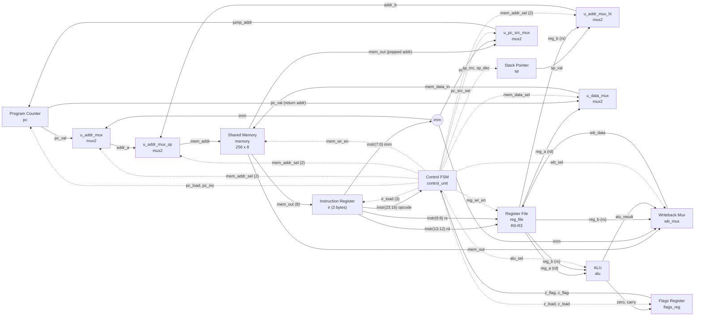
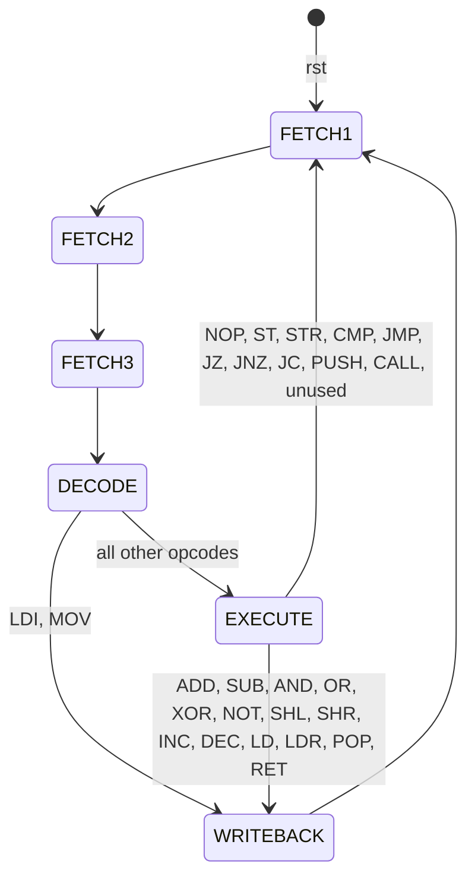
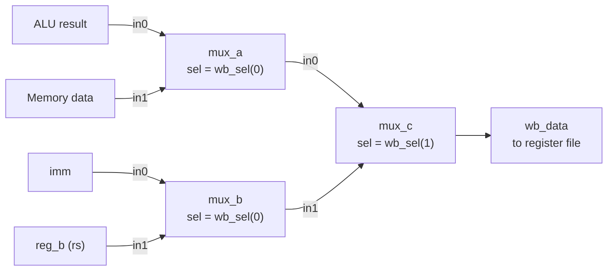
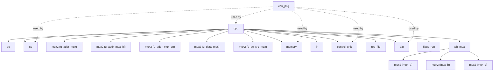

# 8-bit CPU in VHDL — von Neumann version

A simple 8-bit, **multi-cycle**, **von Neumann** CPU written in VHDL and
verified with self-checking testbenches in the Vivado behavioral simulator (XSIM).

This branch starts from the `multicycle` branch (Harvard, 24-bit instructions,
20 instructions) and replaces the separate instruction ROM and data RAM with
**one shared 256 x 8 memory** that holds both the program and the data. Each
24-bit instruction is stored as three bytes and fetched one byte per clock, so
the FSM gains two more fetch states. The instruction set and every other
datapath component are unchanged.

On top of that, the CPU has a **hardware stack**: a stack pointer and four new
instructions, PUSH, POP, CALL and RET, so programs can save registers and call
subroutines, including nested calls. The stack lives in the same shared memory,
growing down from `EF`.

LD and ST can also take their address from a register (**register-indirect
addressing**, LDR and STR), so a program can walk through memory with a pointer.

**Status:** RTL complete. All 11 testbenches pass. Synthesizes in Vivado with
0 warnings, and the shared memory is inferred as one block RAM (RAMB18).

> **Branches**
>
> | Branch | Version | Status |
> |---|---|---|
> | `single-cycle` | Single-cycle CPU, 16-bit instructions (tag `v1.0-single-cycle`) | Complete, frozen |
> | `multicycle` | Multi-cycle Harvard CPU with an FSM control unit, 24-bit instructions, 20 instructions (tag `v1.1-multicycle-harvard`) | Complete, frozen |
> | `von-neumann` | Multi-cycle von Neumann CPU: one shared 256 x 8 memory, byte-wise fetch, hardware stack with PUSH/POP/CALL/RET, register-indirect LDR/STR (tag `v1.2-multicycle-von-neumann`) | Actively under development (this branch) |
>
> `single-cycle` and `multicycle` are frozen. All further development happens on `von-neumann`.

---

## Table of contents

- [Features](#features)
- [Harvard vs von Neumann](#harvard-vs-von-neumann)
- [Memory](#memory)
  - [Memory map](#memory-map)
  - [Instruction layout in memory](#instruction-layout-in-memory)
  - [Program file](#program-file)
  - [Synchronous read](#synchronous-read)
- [Stack](#stack)
- [Register-indirect addressing](#register-indirect-addressing)
- [Architecture](#architecture)
  - [Design decisions](#design-decisions)
  - [Datapath](#datapath)
  - [Control FSM](#control-fsm)
  - [Fetch timing](#fetch-timing)
  - [Cycles per instruction](#cycles-per-instruction)
  - [Writeback multiplexer](#writeback-multiplexer)
- [Instruction set](#instruction-set)
- [ALU](#alu)
- [Control unit](#control-unit)
- [Components](#components)
- [Project structure](#project-structure)
- [Running the simulation](#running-the-simulation)
- [Synthesis](#synthesis)
- [Verification](#verification)
- [Writing your own program](#writing-your-own-program)
- [Limitations](#limitations)
- [Future work](#future-work)

---

## Features

- 8-bit data path, 8-bit program counter (256 byte addresses)
- **Von Neumann architecture:** one 256 x 8 memory for code, data and the stack
- Synchronous-read memory, read-first on writes, inferred as one block RAM (RAMB18) in synthesis
- Program loaded from a text file (`program.mem`) at simulation start, so programs change without editing VHDL
- 24-bit byte-aligned instruction word, 26 instructions (8-bit opcode, room for 256)
- Instructions fetched one byte per clock (FETCH1, FETCH2, FETCH3)
- Four 8-bit general-purpose registers (R0-R3)
- 8-bit stack pointer and a descending stack: PUSH, POP, CALL, RET, with nested calls
- Direct (LD/ST) and register-indirect (LDR/STR) memory addressing
- Zero (Z) and Carry (C) flags with independent load enables
- **Multi-cycle execution:** 5 or 6 clocks per instruction, driven by a 6-state FSM
- 24-bit instruction register (IR) with one load enable per byte
- Unused opcodes decode safely as NOP
- Synchronous reset
- Point-to-point datapath with multiplexers (no tri-state bus)
- Self-checking testbenches for every component, plus a full-system testbench that checks the FSM state on every cycle

---

## Harvard vs von Neumann

| | Harvard (`multicycle`) | Von Neumann (this branch) |
|---|---|---|
| Memories | 256 x 24 instruction ROM + 256 x 8 data RAM | One 256 x 8 shared memory |
| Memory read | Asynchronous | Synchronous (one clock latency) |
| Instruction fetch | 1 clock, whole 24-bit word | 3 clocks, one byte each |
| FSM states | 4 | 6 |
| Clocks per instruction | 3 or 4 | 5 or 6 |
| Address source | PC to ROM, imm to RAM | Address muxes: PC, imm for LD/ST, SP for the stack, or a register for LDR/STR |
| IR loading | 24 bits at once | One byte per state (`ir_load(2:0)`) |
| Jump targets | Instruction index | Byte address (3 x instruction index) |
| Code is writable | No | Yes: ST can overwrite instructions |
| Stack and subroutines | No | Yes: SP, PUSH, POP, CALL, RET |
| Test program, reset to first fetch of the halt `JMP` | 71 cycles | 394 cycles (longer program with subroutines and a pointer loop) |

Both designs share the original 20 instructions, register file, ALU, flags register, writeback mux
and PC. The multi-cycle structure is what makes the shared memory possible:
instruction fetch and data access happen in different states, so they never
need the memory in the same clock.

---

## Memory

`memory.vhd` is a 256 x 8 array with a synchronous write and a synchronous
read. It has no reset, so its contents survive a CPU reset.

### Memory map

| Range | Use |
|---|---|
| `00`-`9B` | Test program (52 instructions x 3 bytes) |
| `9C`-`EC` | Free (reads as `00` = NOP) |
| `ED`-`EF` | Stack used by the test program (grows down from `EF`) |
| `F0`-`FF` | Data area used by LD/ST and LDR/STR (the test program uses `F0`-`F3`) |

Nothing stops a program from writing into the code area, or a deep stack from
growing into code: memory is just bytes.

### Instruction layout in memory

Instruction *n* starts at byte address 3*n*. The opcode is at the lowest
address, so the bytes in memory read in the same order as the hex:

```
Address   Byte   Part of instruction
  00       01    opcode   ─┐
  01       00    rd | rs   ├─ LDI R0, 0F  (01000F)
  02       0F    imm      ─┘
  03       01    opcode   ─┐
  04       10    rd | rs   ├─ LDI R1, 3C  (01103C)
  05       3C    imm      ─┘
```

### Program file

The program lives in `rtl/program.mem`, a text file with one 24-bit
instruction per line as 6 hex digits:

```
-- comment lines start with two dashes (no leading spaces)
01000F   -- 00: LDI R0, 0F
01103C   -- 03: LDI R1, 3C
```

| Line | Handling |
|---|---|
| Empty | Skipped |
| Starts with a dash, i.e. a `--` comment | Skipped |
| 6 hex digits at the start of the line (no leading spaces), optionally followed by text | Instruction *n* (counting only instruction lines) goes to `3n`, `3n+1`, `3n+2`; the text after the digits is ignored, so it can hold a comment |
| Not valid hex | Elaboration stops: `program.mem line N: bad hex` |
| An 86th instruction | Elaboration stops: `program.mem line N: program too long (max 85 instructions)` (85 x 3 = 255 bytes) |

The impure function `load_mem` in `memory.vhd` reads each line with `std.textio`
only: `read` for the first character and `hread` for the other five digits.
It never indexes the line string, because Vivado synthesis does not support
that, so the same code loads the program in both simulation and synthesis. It
returns the initial 256-byte image that initialises the `mem` signal.
Addresses the program does not fill hold `00` (NOP). The file name is the
generic `init_file` (default `"program.mem"`). The file is loaded once, when
the simulation starts; a CPU reset does not reload it.

### Synchronous read

`data_out` shows the byte at `addr` **one clock after** the address is
applied, like FPGA block RAM, and synthesis maps it to one (see [Synthesis](#synthesis)). On a write edge the read returns the old byte
(read-first). The FSM is built around that one-clock latency:

- Each instruction byte is requested in one state and loaded into the IR in the next.
- LD puts imm on the address in EXECUTE; the byte arrives in WRITEBACK, which is where the register file writes it.
- POP and RET read the stack the same way: SP goes out in EXECUTE, the byte arrives in WRITEBACK.
- LDR does the same with the address from a register.

---

## Stack

`sp.vhd` is an 8-bit stack pointer with increment and decrement enables. It
resets to `SP_INIT` = `F0`.

**Convention:** SP points to the **last byte pushed**, and the stack grows
**down**. The first push goes to `EF`, so the stack never touches the data area
`F0`-`FF`.

| Opcode | Instruction | Operation |
|---|---|---|
| 14 | `PUSH rd` | SP = SP - 1, then MEM[SP] = rd |
| 15 | `POP rd` | rd = MEM[SP], then SP = SP + 1 |
| 16 | `CALL addr` | SP = SP - 1, MEM[SP] = PC (return address), PC = addr |
| 17 | `RET` | PC = MEM[SP], then SP = SP + 1 |

The return address is free: by EXECUTE the PC has already advanced three times
in FETCH, so it points at the instruction after the `CALL`.

All four fit into the existing six states; no new states were needed:

| Instruction | DECODE | EXECUTE | WRITEBACK | Clocks |
|---|---|---|---|---|
| PUSH | `sp_dec` | address = SP, write rd | — | 5 |
| POP | — | address = SP (read), `sp_inc` | rd = memory byte | 6 |
| CALL | `sp_dec` | address = SP, write PC, `pc_load` from imm | — | 5 |
| RET | — | address = SP (read), `sp_inc` | `pc_load` from the memory byte | 6 |

- **Decrement in DECODE**, so the new SP is already on the address in EXECUTE (pre-decrement without an extra state).
- **CALL writes and jumps on the same edge:** the memory stores the old PC (the return address) while the PC loads imm.
- **POP and RET read like LD:** the address is captured at the end of EXECUTE, before `sp_inc` changes SP, and the byte arrives in WRITEBACK.

Multiplexers added to the datapath for the stack (the address mux later gained a fourth input for register-indirect addressing):

| Mux | Inputs | Select |
|---|---|---|
| Memory address (three `mux2` as a 4-to-1) | PC, imm, SP, register | `mem_addr_sel` (2 bits: `ADDR_PC`, `ADDR_IMM`, `ADDR_SP`, `ADDR_REG`) |
| Memory write data | `reg_a`, PC | `mem_data_sel` (`MEMD_REG`, `MEMD_PC`) |
| PC jump address | imm, memory output | `pc_src_sel` (`PCSRC_IMM`, `PCSRC_MEM`) |

There is no overflow or underflow detection: SP simply wraps.

---

## Register-indirect addressing

LD and ST take their address from imm, which is fixed in the program. LDR and
STR take it from the **rs register** instead, so the address can be computed
and changed at run time (a pointer):

| Opcode | Instruction | Operation | Path | Clocks |
|---|---|---|---|---|
| 18 | `LDR rd, [rs]` | rd = MEM[rs] | like LD: F1 F2 F3 D E W | 6 |
| 19 | `STR rd, [rs]` | MEM[rs] = rd | like ST: F1 F2 F3 D E | 5 |

In both, **rd is the data register and rs holds the address**. `reg_b` already
carries R[rs] from DECODE, so the address is ready in EXECUTE; the only change
from LD/ST is `mem_addr_sel = ADDR_REG` instead of `ADDR_IMM`.

The address mux became a 4-to-1, built from three `mux2` in the same shape as
`wb_mux`:

| `mem_addr_sel` | Constant | `u_addr_mux` (bit 0) | `u_addr_mux_hi` (bit 0) | `u_addr_mux_sp` (bit 1) | Address |
|---|---|---|---|---|---|
| `00` | `ADDR_PC` | PC | | `addr_a` | PC |
| `01` | `ADDR_IMM` | imm | | `addr_a` | imm |
| `10` | `ADDR_SP` | | SP | `addr_b` | SP |
| `11` | `ADDR_REG` | | `reg_b` (rs) | `addr_b` | rs register |

---

## Architecture

### Design decisions

| Topic | Decision | Reason |
|---|---|---|
| Memory model | Von Neumann: one memory for code and data | The point of this branch. Fetch and data access are in different FSM states, so one port is enough |
| Memory width | 8 bits | Matches the data width; a 24-bit instruction is three bytes with no wasted bits |
| Memory read | Synchronous, read-first | Matches FPGA block RAM (synthesis infers one RAMB18); the FSM absorbs the one-clock latency |
| Address source | Three `mux2` as a 4-to-1 selecting PC, imm, SP or a register (`mem_addr_sel`, 2 bits) | PC for every fetch; imm in EXECUTE for LD and ST; SP for the stack instructions; rs for LDR and STR |
| Stack | SP points to the last pushed byte, grows down from `F0`; reset to `F0` | Standard convention; keeps the stack out of the data area `F0`-`FF` |
| Stack in the FSM | Decrement in DECODE, access in EXECUTE, use popped byte in WRITEBACK | Fits PUSH/POP/CALL/RET into the existing six states |
| Fetch | Three states, one byte each, PC +1 in each | Keeps the 24-bit format from the `multicycle` branch unchanged |
| IR | Three byte registers with independent enables | Each byte loads in its own state; independent enables, not a priority chain |
| Byte order | Opcode at the lowest address | Memory dumps read like the instruction hex |
| Jump targets | Byte addresses | The PC addresses bytes; instruction *n* is at 3*n* |
| Interconnect | Point-to-point wiring plus multiplexers | FPGA fabric has no internal tri-state buses |
| Registers | 4 x 8-bit (R0-R3) | Only 2 bits of each 4-bit rd/rs field are wired |
| Opcode decoding | All 8 bits decoded; unused opcodes fall to `others` | Opcodes `14`-`FF` behave as NOP instead of aliasing real instructions |
| Holding registers | IR only | Registers change only in WRITEBACK, so ALU inputs stay stable from DECODE to WRITEBACK |
| Selects vs enables | Selects (`alu_sel`, `wb_sel`, `mem_data_sel`, `pc_src_sel`) from the opcode only; enables and `mem_addr_sel` from the state | Selects choose *what*; enables decide *when* |
| Reset | Synchronous, highest priority | PC, SP (to `F0`), IR, register file, flags register and FSM (back to FETCH1). The memory has no reset |
| Flags | Zero and Carry only | Enough for JZ, JNZ and JC |
| Carry on SUB | Borrow convention: C = 1 when a < b | `JC` after `CMP a, b` means "jump if a < b" (unsigned) |
| Carry on shifts | C = the bit shifted out | Lets a program test the dropped bit with `JC` |

### Datapath



Solid arrows are data; dotted arrows are control signals from the FSM.

Compared with the `multicycle` branch: the ROM and RAM are replaced by one
`memory`; three address muxes choose the PC, imm, SP or a register; the memory
output feeds the IR (one byte at a time), the writeback mux and the PC (for
RET); the memory write data is a register or the PC (for CALL); and the IR has
three byte enables.

The address muxes decode `mem_addr_sel` directly: bit 0 picks PC or imm in
`u_addr_mux` and SP or the rs register in `u_addr_mux_hi`; bit 1 picks between
the two in `u_addr_mux_sp`.

| `mem_addr_sel` | Constant | Address |
|---|---|---|
| `00` | `ADDR_PC` | PC |
| `01` | `ADDR_IMM` | imm |
| `10` | `ADDR_SP` | SP |
| `11` | `ADDR_REG` | rs register |

### Control FSM



| State | Memory address | Work done | Enables active |
|---|---|---|---|
| FETCH1 | PC | Request byte 0 (opcode); PC increments | `pc_inc` |
| FETCH2 | PC | Opcode arrives and loads into IR(23:16); request byte 1; PC increments | `pc_inc`, `ir_load = 100` |
| FETCH3 | PC | rd/rs byte loads into IR(15:8); request byte 2; PC increments | `pc_inc`, `ir_load = 010` |
| DECODE | PC | imm byte loads into IR(7:0); next state chosen from the opcode; SP decrements for PUSH/CALL | `ir_load = 001`, `sp_dec` (PUSH, CALL) |
| EXECUTE | imm for LD/ST, rs for LDR/STR, SP for PUSH/POP/CALL/RET, otherwise PC | ALU result settles; flags load; ST/STR/PUSH/CALL write memory; LD/LDR/POP/RET request their byte; jumps and CALL load the PC; SP increments for POP/RET | `z_load`, `c_load`, `mem_wr_en`, `pc_load`, `sp_inc` (per opcode) |
| WRITEBACK | PC | Result (or LD/LDR/POP byte) written to rd; RET loads the PC from the popped byte instead | `reg_wr_en`, or `pc_load` for RET |

### Fetch timing

Because the memory read is synchronous, each byte is loaded one state after
it is requested:

| State | Address on memory | `mem_out` during this state | IR loads at the end |
|---|---|---|---|
| FETCH1 | PC | (previous) | — |
| FETCH2 | PC + 1 | opcode | IR(23:16) |
| FETCH3 | PC + 2 | rd/rs | IR(15:8) |
| DECODE | PC + 3 | imm | IR(7:0) |

The opcode is in the IR from FETCH3, so DECODE can choose the next state; rd/rs
are ready in DECODE; imm is ready from EXECUTE, which is the first state that
uses it. Until then the IR holds a mix of the new and old instruction's bytes;
nothing reads the stale bytes.

### Cycles per instruction

| Instructions | Path | Clocks |
|---|---|---|
| NOP, ST, STR, CMP, JMP, JZ, JNZ, JC, PUSH, CALL, unused opcodes | FETCH1 → FETCH2 → FETCH3 → DECODE → EXECUTE | 5 |
| LDI, MOV | FETCH1 → FETCH2 → FETCH3 → DECODE → WRITEBACK | 5 |
| ADD, SUB, AND, OR, XOR, NOT, SHL, SHR, INC, DEC, LD, LDR, POP, RET | FETCH1 → FETCH2 → FETCH3 → DECODE → EXECUTE → WRITEBACK | 6 |

### Writeback multiplexer

`wb_mux` is a 4-to-1 multiplexer built from three 2-to-1 multiplexers (`mux2`):



| wb_sel | Constant | Source | Used by |
|---|---|---|---|
| 00 | `WB_ALU` | ALU result | ADD, SUB, AND, OR, XOR, NOT, SHL, SHR, INC, DEC |
| 01 | `WB_RAM` | Shared memory | LD, LDR, POP |
| 10 | `WB_IMM` | Immediate | LDI |
| 11 | `WB_REG` | rs register | MOV |

---

## Instruction set

The `multicycle` branch's 20 instructions, plus the four stack instructions and the two register-indirect loads and stores.
Jump, CALL and LD/ST addresses, and the pointers in LDR/STR, are byte addresses in the shared memory.

### Instruction format

```
 23            16 15    12 11     8 7             0
+----------------+--------+--------+---------------+
|     opcode     |   rd   |   rs   |      imm      |
+----------------+--------+--------+---------------+
      8 bits       4 bits   4 bits      8 bits
   byte at 3n      byte at 3n+1       byte at 3n+2
```

Unused fields are 0. Only R0-R3 exist, so the upper 2 bits of rd and rs must
be 0. In hexadecimal: digits 1-2 are the opcode, digit 3 is rd, digit 4 is rs,
digits 5-6 are imm.

### Instructions

| Opcode | Mnemonic | Operation | Flags |
|---|---|---|---|
| 00 | `NOP` | No operation | - |
| 01 | `LDI rd, imm` | rd = imm | - |
| 02 | `MOV rd, rs` | rd = rs | - |
| 03 | `LD rd, addr` | rd = MEM[addr] | - |
| 04 | `ST rd, addr` | MEM[addr] = rd | - |
| 05 | `ADD rd, rs` | rd = rd + rs | Z, C |
| 06 | `SUB rd, rs` | rd = rd - rs | Z, C |
| 07 | `AND rd, rs` | rd = rd and rs | Z |
| 08 | `OR rd, rs` | rd = rd or rs | Z |
| 09 | `XOR rd, rs` | rd = rd xor rs | Z |
| 0A | `NOT rd` | rd = not rd | Z |
| 0B | `CMP rd, rs` | Compute rd - rs, set flags, discard result | Z, C |
| 0C | `JMP addr` | PC = addr | - |
| 0D | `JZ addr` | PC = addr if Z = 1 | - |
| 0E | `JNZ addr` | PC = addr if Z = 0 | - |
| 0F | `JC addr` | PC = addr if C = 1 | - |
| 10 | `SHL rd` | rd = rd shifted left one bit, 0 into bit 0 | Z, C |
| 11 | `SHR rd` | rd = rd shifted right one bit (logical), 0 into bit 7 | Z, C |
| 12 | `INC rd` | rd = rd + 1 | Z, C |
| 13 | `DEC rd` | rd = rd - 1 | Z, C |
| 14 | `PUSH rd` | SP = SP - 1, MEM[SP] = rd | - |
| 15 | `POP rd` | rd = MEM[SP], SP = SP + 1 | - |
| 16 | `CALL addr` | SP = SP - 1, MEM[SP] = return address, PC = addr | - |
| 17 | `RET` | PC = MEM[SP], SP = SP + 1 | - |
| 18 | `LDR rd, [rs]` | rd = MEM[rs] | - |
| 19 | `STR rd, [rs]` | MEM[rs] = rd | - |
| 1A-FF | (unused) | Behaves as NOP | - |

`JMP` to its own address acts as a halt (the FSM keeps cycling FETCH1 to EXECUTE on it).

### Flags

| Flag | Set when | Updated by | Read by |
|---|---|---|---|
| Z (zero) | ALU result is 00 | ADD, SUB, CMP, AND, OR, XOR, NOT, SHL, SHR, INC, DEC | JZ, JNZ |
| C (carry) | See the table below | ADD, SUB, CMP, SHL, SHR, INC, DEC | JC |

| Instruction | C = 1 when |
|---|---|
| ADD | The sum overflows past FF |
| SUB, CMP | Borrow: rd < rs |
| SHL | Bit 7 of rd was 1 (shifted out) |
| SHR | Bit 0 of rd was 1 (shifted out) |
| INC | rd was FF (wraps to 00) |
| DEC | rd was 00 (borrow, wraps to FF) |

Logic operations update Z but keep C, so the flags register has a separate load enable per flag.

---

## ALU

`alu.vhd` is combinational and unchanged from the `multicycle` branch.

| Code | Constant | Result | Carry |
|---|---|---|---|
| 0000 | `ALU_ADD` | a + b | Overflow |
| 0001 | `ALU_SUB` | a - b | Borrow |
| 0010 | `ALU_AND` | a and b | 0 |
| 0011 | `ALU_OR` | a or b | 0 |
| 0100 | `ALU_XOR` | a xor b | 0 |
| 0101 | `ALU_NOT` | not a | 0 |
| 0110 | `ALU_SHL` | a(6:0) & '0' | a(7) |
| 0111 | `ALU_SHR` | '0' & a(7:1) | a(0) |
| 1000 | `ALU_INC` | a + 1 | Overflow |
| 1001 | `ALU_DEC` | a - 1 | Borrow |
| 1010-1111 | (spare) | 00 | 0 |

---

## Control unit

`control_unit.vhd` is a three-process FSM:

| Process | Type | Contents |
|---|---|---|
| `state_reg` | Clocked | Synchronous reset to FETCH1, otherwise `state <= next_state` |
| `next_state_logic` | Combinational | Transition table below |
| `output_logic` | Combinational | Defaults, then selects from the opcode, then enables from the state |

The state type `state_t`, the select constants `ADDR_*`, `MEMD_*` and `PCSRC_*`, and `SP_INIT` are declared in `cpu_pkg`.

### Next state

| Current | Condition | Next |
|---|---|---|
| FETCH1 | always | FETCH2 |
| FETCH2 | always | FETCH3 |
| FETCH3 | always | DECODE |
| DECODE | LDI, MOV | WRITEBACK |
| DECODE | otherwise | EXECUTE |
| EXECUTE | ADD, SUB, AND, OR, XOR, NOT, SHL, SHR, INC, DEC, LD, LDR, POP, RET | WRITEBACK |
| EXECUTE | otherwise | FETCH1 |
| WRITEBACK | always | FETCH1 |

### Selects (from the opcode, in every state)

| Opcode | alu_sel | wb_sel | mem_data_sel | pc_src_sel |
|---|---|---|---|---|
| ADD | ADD | ALU | REG | IMM |
| SUB, CMP | SUB | ALU | REG | IMM |
| AND / OR / XOR / NOT | AND / OR / XOR / NOT | ALU | REG | IMM |
| SHL / SHR / INC / DEC | SHL / SHR / INC / DEC | ALU | REG | IMM |
| LDI | ADD | IMM | REG | IMM |
| MOV | ADD | REG | REG | IMM |
| LD, LDR, POP | ADD | RAM | REG | IMM |
| CALL | ADD | ALU | **PC** | IMM |
| RET | ADD | ALU | REG | **MEM** |
| others | ADD | ALU | REG | IMM |

### Enables and address select (by state)

| State | Opcode | Outputs = 1 (or non-default) |
|---|---|---|
| FETCH1 | any | `pc_inc` |
| FETCH2 | any | `pc_inc`, `ir_load = 100` |
| FETCH3 | any | `pc_inc`, `ir_load = 010` |
| DECODE | any | `ir_load = 001` |
| DECODE | PUSH, CALL | also `sp_dec` |
| EXECUTE | ADD, SUB, CMP, SHL, SHR, INC, DEC | `z_load`, `c_load` |
| EXECUTE | AND, OR, XOR, NOT | `z_load` |
| EXECUTE | LD | `mem_addr_sel = ADDR_IMM` |
| EXECUTE | ST | `mem_wr_en`, `mem_addr_sel = ADDR_IMM` |
| EXECUTE | LDR | `mem_addr_sel = ADDR_REG` |
| EXECUTE | STR | `mem_wr_en`, `mem_addr_sel = ADDR_REG` |
| EXECUTE | JMP | `pc_load` |
| EXECUTE | JZ / JNZ / JC | `pc_load` = Z / not Z / C |
| EXECUTE | PUSH | `mem_wr_en`, `mem_addr_sel = ADDR_SP` |
| EXECUTE | POP | `sp_inc`, `mem_addr_sel = ADDR_SP` |
| EXECUTE | CALL | `mem_wr_en`, `pc_load`, `mem_addr_sel = ADDR_SP` |
| EXECUTE | RET | `sp_inc`, `mem_addr_sel = ADDR_SP` |
| EXECUTE | NOP, unused | none |
| WRITEBACK | RET | `pc_load` (no register write) |
| WRITEBACK | all others | `reg_wr_en` |

`mem_addr_sel` defaults to `ADDR_PC`, so every fetch reads from the PC.

---

## Components

| Entity | File | Type | Description |
|---|---|---|---|
| `cpu_pkg` | `cpu_pkg.vhd` | Package | 8-bit `OP_*`, 4-bit `ALU_*`, 4-bit `REG0`-`REG3`, 2-bit `WB_*`, 2-bit `ADDR_*` (including `ADDR_REG`), `MEMD_*`, `PCSRC_*`, `SP_INIT`, and the FSM state type `state_t` |
| `cpu` | `cpu.vhd` | Structural | Top level; instantiates and wires every component. Exposes debug outputs |
| `pc` | `pc.vhd` | Sequential | 8-bit program counter. Priority: reset > load > increment > hold |
| `sp` | `sp.vhd` | Sequential | **New.** 8-bit stack pointer, resets to `F0`. Priority: reset > decrement > increment > hold |
| `memory` | `memory.vhd` | Sequential | **New.** 256 x 8 shared memory, synchronous read-first, loads the program from `program.mem`, no reset |
| `ir` | `ir.vhd` | Sequential | **Changed.** 24-bit instruction register loaded one byte at a time |
| `control_unit` | `control_unit.vhd` | Sequential (FSM) | **Changed.** 6-state control FSM, including the stack and register-indirect instructions |
| `reg_file` | `reg_file.vhd` | Sequential | 4 x 8-bit registers, two asynchronous read ports, one synchronous write port |
| `alu` | `alu.vhd` | Combinational | ADD, SUB, AND, OR, XOR, NOT, SHL, SHR, INC, DEC with zero and carry outputs |
| `flags_reg` | `flags_reg.vhd` | Sequential | Stores Z and C with independent load enables |
| `wb_mux` | `wb_mux.vhd` | Structural | 4-to-1 writeback multiplexer built from three `mux2` |
| `mux2` | `mux2.vhd` | Combinational | 8-bit 2-to-1 multiplexer (gate-level); also used for the three memory address muxes, the memory data mux and the PC source mux |

`instr_rom` and `data_ram` from the `multicycle` branch are not used here.

### Component hierarchy



### Debug outputs

| Port | Width | Shows |
|---|---|---|
| `pc_dbg` | 8 | Program counter (a byte address; it advances in each FETCH state) |
| `sp_dbg` | 8 | Stack pointer |
| `instr_dbg` | 24 | Instruction register (complete from EXECUTE/WRITEBACK) |
| `reg_a_dbg` | 8 | Value of the rd register of the instruction in the IR |
| `z_dbg` | 1 | Stored zero flag |
| `c_dbg` | 1 | Stored carry flag |
| `state_dbg` | `state_t` | Current FSM state |

---

## Project structure

```
8-bit-cpu/
├── rtl/
│   ├── cpu_pkg.vhd
│   ├── cpu.vhd
│   ├── pc.vhd
│   ├── sp.vhd
│   ├── memory.vhd
│   ├── program.mem
│   ├── ir.vhd
│   ├── control_unit.vhd
│   ├── reg_file.vhd
│   ├── alu.vhd
│   ├── flags_reg.vhd
│   ├── wb_mux.vhd
│   └── mux2.vhd
├── tb/
│   ├── tb_cpu.vhd
│   ├── tb_pc.vhd
│   ├── tb_sp.vhd
│   ├── tb_memory.vhd
│   ├── tb_ir.vhd
│   ├── tb_control_unit.vhd
│   ├── tb_reg_file.vhd
│   ├── tb_alu.vhd
│   ├── tb_flags_reg.vhd
│   ├── tb_wb_mux.vhd
│   └── tb_mux2.vhd
├── synthesis/
│   └── cpu_utilization_synth.rpt
└── README.md
```

### Coding conventions

- `std_logic_vector` at ports, `numeric_std` for arithmetic
- Architectures named `rtl` (behavioural), `structural` (instantiation only) or `sim` (testbenches)
- Synchronous active-high reset
- Instances prefixed `u_` in the top level
- Every combinational process assigns defaults before any branching, so no latches are inferred
- Every `case` on the opcode has a `when others` branch, so all 256 opcodes are covered
- Independent load enables are separate `if` statements, not an `elsif` chain
- FSM states as an enumerated type, so waveforms and failure messages show state names

---

## Running the simulation

1. Create a new RTL project in Vivado.
2. **Add design sources:** every file in `rtl/`, including `program.mem`. Vivado lists it as a memory file and copies it into the simulation folder, which is where `memory.vhd` opens it.
3. **Add simulation sources:** every file in `tb/`.
4. **Compile order:** `cpu_pkg.vhd` must compile first (it is used by `alu`, `control_unit`, `memory`, `cpu` and several testbenches). Right-click in Sources → **Hierarchy Update** → **Automatic Update and Compile Order**, then check the **Compile Order** tab.
5. **Run time:** the default 1000 ns is too short for `tb_control_unit` and `tb_cpu`. Set **Settings → Simulation → Simulation → `xsim.simulate.runtime`** to `5000ns`.
6. Right-click the testbench to run → **Set as Top**.
7. **Run Simulation** → **Run Behavioral Simulation**.
8. Check the Tcl Console for `Note: all tests completed and passed`.

If XSIM reports that a unit "needs to be re-saved since 'xil_defaultlib.cpu_pkg' changed", use **Simulation → Reset Behavioral Simulation** and run again.

A failing run stops at the first failed check and prints the testbench's message, for example:

| Testbench | Example message | Meaning |
|---|---|---|
| `tb_cpu` | `cycle 131 failed: sp_dbg` | SP was wrong at cycle 131 |
| `tb_control_unit` | `test 28 RET writeback failed: pc_load` | `pc_load` was wrong in RET's WRITEBACK state |
| `tb_control_unit` | `test 5 ST fetch2 failed: state is S_FETCH1` | The FSM was in FETCH1 instead of FETCH2 during ST |

---

## Synthesis

The design has been synthesized in Vivado 2026.1 to check that it maps to FPGA
resources, in particular that the shared memory becomes block RAM. This is
synthesis only: no constraints, implementation, timing or board.

1. Right-click `cpu` in **Design Sources** → **Set as Top**.
2. **Run Synthesis** (default settings). Any 7-series part works; the results below are for `xc7vx485tffg1157-1`.
3. **Open Synthesized Design** → **Report Utilization**.

The full report is in [`synthesis/cpu_utilization_synth.rpt`](synthesis/cpu_utilization_synth.rpt).

| Resource | Used | Notes |
|---|---|---|
| Slice LUTs | 155 | ALU, muxes, control logic and the register-file read ports |
| Slice registers | 80 | PC 8, SP 8, IR 24, register file 32, flags 2, FSM 6 |
| F7 muxes | 8 | Register-file read multiplexers |
| Block RAM tile | 0.5 | One RAMB18E1: the 256 x 8 shared memory |
| Bonded IOB | 55 | `clk`, `rst` and the 53 debug output bits |
| BUFGCTRL | 1 | Clock buffer |

- **Block RAM:** the synthesis log's *Block RAM: Final Mapping Report* lists `u_memory/mem_reg` as 256 x 8, READ_FIRST, on one RAMB18. No attribute was needed: the synchronous, read-first, single-address `memory.vhd` is inferred as block RAM as written. The program image from `load_mem` (read from `program.mem`) becomes the RAM's initial contents.
- **FSM:** Vivado recognises the control unit as a state machine and re-encodes the six states one-hot (hence 6 state registers instead of 3).
- **Registers that reset to 1:** five of the registers are `FDSE` (set on reset): the four set bits of SP's reset value `F0` and the FETCH1 bit of the one-hot state.
- **Messages:** 0 errors, 0 critical warnings, 0 warnings. One info message (`Synth 8-7052`) notes that timing could improve with an extra output register merged into the block RAM; that would make every read take two clocks, so it is not used.

---

## Verification

Every testbench is self-checking (`assert ... severity failure`). The clocked FSM and system testbenches use a `check` procedure so each cycle is one line that compares every output.

### Testbenches

| Testbench | Checks | What is covered | Passes at |
|---|---|---|---|
| `tb_mux2` | 10 | Both select values over several bit patterns | 100 ns |
| `tb_wb_mux` | 6 | All four writeback paths | 60 ns |
| `tb_alu` | 32 | Every operation including SHL/SHR/INC/DEC, carry/borrow and wrap edge cases, spare codes | 320 ns |
| `tb_memory` | 15 | Program bytes loaded from `program.mem`, empty and top addresses, read-first writes, writes to data and code, blocked write, read latency | 150 ns |
| `tb_pc` | 11 | Reset, increment, hold, load priority, wrap | 120 ns |
| `tb_sp` | 10 | Reset to F0, decrement, increment, hold, decrement-over-increment and reset priority, timing | 100 ns |
| `tb_ir` | 11 | Reset, each byte load alone, full assembly, hold, multi-byte loads, reset priority, load timing | 110 ns |
| `tb_flags_reg` | 9 | Independent flag loads, hold, reset priority, timing | 90 ns |
| `tb_reg_file` | 14 | Every register, both ports, reset priority, timing | 140 ns |
| `tb_control_unit` | 170 | Every opcode through its full state sequence, including IR byte loads, memory address and data selects, SP enables and the PC source; each conditional jump both ways; PUSH, POP, CALL, RET, LDR, STR; an unused opcode as NOP; reset mid-instruction | 1700 ns |
| `tb_cpu` | 414 cycles | Full program with nested subroutine calls, a call in a loop and a pointer loop with LDR/STR; FSM state and all debug outputs, including SP, every cycle | 4140 ns |

In `tb_control_unit` the opcode changes only during FETCH1. `mem_addr_sel`, `sp_inc` and `sp_dec` are checked in every state, so a fetch from the wrong address would be caught. The unused-opcode test (`FF`) runs with both flags set, proving an unknown opcode can never trigger a jump.

`tb_ir` loads two and three bytes at once (`111`, `101`), which would fail if the byte enables were a priority chain.

### System test program

The program in `rtl/program.mem`:

| Instr | Addr | Instruction | Bytes | Effect |
|---|---|---|---|---|
| 0 | `00` | `LDI R0, 0F` | `01 00 0F` | R0 = 0F |
| 1 | `03` | `LDI R1, 3C` | `01 10 3C` | R1 = 3C |
| 2 | `06` | `MOV R2, R1` | `02 21 00` | R2 = 3C |
| 3 | `09` | `ADD R2, R0` | `05 20 00` | R2 = 4B |
| 4 | `0C` | `AND R2, R1` | `07 21 00` | R2 = 08 |
| 5 | `0F` | `OR R2, R0` | `08 20 00` | R2 = 0F |
| 6 | `12` | `XOR R2, R0` | `09 20 00` | R2 = 00, Z = 1 |
| 7 | `15` | `JZ 1B` | `0D 00 1B` | Taken |
| 8 | `18` | `LDI R3, FF` | `01 30 FF` | Must be skipped |
| 9 | `1B` | `NOT R2` | `0A 20 00` | R2 = FF |
| 10 | `1E` | `ST R2, F0` | `04 20 F0` | MEM[F0] = FF |
| 11 | `21` | `LD R3, F0` | `03 30 F0` | R3 = FF |
| 12 | `24` | `SUB R0, R1` | `06 01 00` | R0 = D3, C = 1 (borrow) |
| 13 | `27` | `JC 2D` | `0F 00 2D` | Taken |
| 14 | `2A` | `LDI R3, 00` | `01 30 00` | Must be skipped |
| 15 | `2D` | `CMP R3, R2` | `0B 32 00` | Z = 1, C = 0, R3 unchanged |
| 16 | `30` | `JNZ 99` | `0E 00 99` | Not taken |
| 17 | `33` | `NOP` | `00 00 00` |  |
| 18 | `36` | `INC R2` | `12 20 00` | R2 = 00 (FF wraps), Z = 1, C = 1 |
| 19 | `39` | `DEC R1` | `13 10 00` | R1 = 3B, Z = 0, C = 0 |
| 20 | `3C` | `SHL R0` | `10 00 00` | R0 = A6, C = 1 (bit 7 out) |
| 21 | `3F` | `SHR R0` | `11 00 00` | R0 = 53, C = 0 (bit 0 out) |
| 22 | `42` | `CALL 5A` | `16 00 5A` | SP = EF, MEM[EF] = 45, go to subroutine 1 |
| 23 | `45` | `PUSH R0` | `14 00 00` | SP = EF, MEM[EF] = 54 |
| 24 | `48` | `POP R2` | `15 20 00` | R2 = 54, SP = F0 |
| 25 | `4B` | `LDI R3, 03` | `01 30 03` | Loop counter |
| 26 | `4E` | `CALL 69` | `16 00 69` | Loop body: call subroutine 2 |
| 27 | `51` | `DEC R3` | `13 30 00` |  |
| 28 | `54` | `JNZ 4E` | `0E 00 4E` | Taken twice, then falls through (R0 = 57) |
| 29 | `57` | `JMP 6F` | `0C 00 6F` | On to the register-indirect section |
| 30 | `5A` | `PUSH R1` | `14 10 00` | Subroutine 1: SP = EE, MEM[EE] = 3B |
| 31 | `5D` | `LDI R1, 77` | `01 10 77` | R1 = 77 (clobber) |
| 32 | `60` | `CALL 69` | `16 00 69` | Nested call: SP = ED, MEM[ED] = 63 |
| 33 | `63` | `POP R1` | `15 10 00` | R1 = 3B restored, SP = EF |
| 34 | `66` | `RET` | `17 00 00` | PC = 45, SP = F0 |
| 35 | `69` | `INC R0` | `12 00 00` | Subroutine 2: R0 = R0 + 1 |
| 36 | `6C` | `RET` | `17 00 00` |  |
| 37 | `6F` | `LDI R3, F1` | `01 30 F1` | Pointer |
| 38 | `72` | `STR R0, [R3]` | `19 03 00` | MEM[F1] = 57 |
| 39 | `75` | `INC R3` | `12 30 00` | Pointer = F2 |
| 40 | `78` | `STR R1, [R3]` | `19 13 00` | MEM[F2] = 3B |
| 41 | `7B` | `INC R3` | `12 30 00` | Pointer = F3 |
| 42 | `7E` | `STR R2, [R3]` | `19 23 00` | MEM[F3] = 54 |
| 43 | `81` | `LDI R0, 00` | `01 00 00` | Sum |
| 44 | `84` | `LDI R3, F1` | `01 30 F1` | Pointer back to F1 |
| 45 | `87` | `LDI R2, 03` | `01 20 03` | Counter |
| 46 | `8A` | `LDR R1, [R3]` | `18 13 00` | Loop: R1 = MEM[pointer] |
| 47 | `8D` | `ADD R0, R1` | `05 01 00` | Sum |
| 48 | `90` | `INC R3` | `12 30 00` | Next byte |
| 49 | `93` | `DEC R2` | `13 20 00` |  |
| 50 | `96` | `JNZ 8A` | `0E 00 8A` | Taken twice, then falls through |
| 51 | `99` | `JMP 99` | `0C 00 99` | Halt (R0 = E6) |

**Final state:** R0 = `E6` (57 + 3B + 54), R1 = `54`, R2 = `00`, R3 = `F4`, Z = 1, C = 0, SP = `F0`; MEM[F0-F3] = `FF 57 3B 54`. The stack reached a depth of 3 (`ED`-`EF`) during the nested call.

### Expected trace

Checked by `tb_cpu` at each falling edge. Values are hexadecimal.

How to read it:
- **The PC increments in each FETCH state**, so by DECODE it already points at the next instruction (instruction address + 3).
- **The IR fills one byte per state.** During FETCH2, FETCH3 and DECODE it holds a mix of the new and the previous instruction's bytes; it is complete from EXECUTE (or WRITEBACK for LDI/MOV). Cycle 0 shows `000000` from reset.
- **Results appear one state later**: a WRITEBACK's value is visible at the next FETCH1; flags loaded in EXECUTE are visible from the next state.
- **SP changes at the end of DECODE** (PUSH, CALL) or **EXECUTE** (POP, RET), so the new value is visible from the next state.
- **The halt** cycles FETCH1 to EXECUTE on `JMP 99`, so the PC runs 99, 9A, 9B, 9C, 9C and jumps back.

| Cycle | State | PC | SP | IR | Instruction being executed | reg_a | Z | C |
|---|---|---|---|---|---|---|---|---|
| 0 | FETCH1 | 00 | F0 | `000000` | LDI R0, 0F | 00 | 0 | 0 |
| 1 | FETCH2 | 01 | F0 | `000000` | LDI R0, 0F | 00 | 0 | 0 |
| 2 | FETCH3 | 02 | F0 | `010000` | LDI R0, 0F | 00 | 0 | 0 |
| 3 | DECODE | 03 | F0 | `010000` | LDI R0, 0F | 00 | 0 | 0 |
| 4 | WRITEBACK | 03 | F0 | `01000F` | LDI R0, 0F | 00 | 0 | 0 |
| 5 | FETCH1 | 03 | F0 | `01000F` | LDI R1, 3C | 0F | 0 | 0 |
| 6 | FETCH2 | 04 | F0 | `01000F` | LDI R1, 3C | 0F | 0 | 0 |
| 7 | FETCH3 | 05 | F0 | `01000F` | LDI R1, 3C | 0F | 0 | 0 |
| 8 | DECODE | 06 | F0 | `01100F` | LDI R1, 3C | 00 | 0 | 0 |
| 9 | WRITEBACK | 06 | F0 | `01103C` | LDI R1, 3C | 00 | 0 | 0 |
| 10 | FETCH1 | 06 | F0 | `01103C` | MOV R2, R1 | 3C | 0 | 0 |
| 11 | FETCH2 | 07 | F0 | `01103C` | MOV R2, R1 | 3C | 0 | 0 |
| 12 | FETCH3 | 08 | F0 | `02103C` | MOV R2, R1 | 3C | 0 | 0 |
| 13 | DECODE | 09 | F0 | `02213C` | MOV R2, R1 | 00 | 0 | 0 |
| 14 | WRITEBACK | 09 | F0 | `022100` | MOV R2, R1 | 00 | 0 | 0 |
| 15 | FETCH1 | 09 | F0 | `022100` | ADD R2, R0 | 3C | 0 | 0 |
| 16 | FETCH2 | 0A | F0 | `022100` | ADD R2, R0 | 3C | 0 | 0 |
| 17 | FETCH3 | 0B | F0 | `052100` | ADD R2, R0 | 3C | 0 | 0 |
| 18 | DECODE | 0C | F0 | `052000` | ADD R2, R0 | 3C | 0 | 0 |
| 19 | EXECUTE | 0C | F0 | `052000` | ADD R2, R0 | 3C | 0 | 0 |
| 20 | WRITEBACK | 0C | F0 | `052000` | ADD R2, R0 | 3C | 0 | 0 |
| 21 | FETCH1 | 0C | F0 | `052000` | AND R2, R1 | 4B | 0 | 0 |
| 22 | FETCH2 | 0D | F0 | `052000` | AND R2, R1 | 4B | 0 | 0 |
| 23 | FETCH3 | 0E | F0 | `072000` | AND R2, R1 | 4B | 0 | 0 |
| 24 | DECODE | 0F | F0 | `072100` | AND R2, R1 | 4B | 0 | 0 |
| 25 | EXECUTE | 0F | F0 | `072100` | AND R2, R1 | 4B | 0 | 0 |
| 26 | WRITEBACK | 0F | F0 | `072100` | AND R2, R1 | 4B | 0 | 0 |
| 27 | FETCH1 | 0F | F0 | `072100` | OR R2, R0 | 08 | 0 | 0 |
| 28 | FETCH2 | 10 | F0 | `072100` | OR R2, R0 | 08 | 0 | 0 |
| 29 | FETCH3 | 11 | F0 | `082100` | OR R2, R0 | 08 | 0 | 0 |
| 30 | DECODE | 12 | F0 | `082000` | OR R2, R0 | 08 | 0 | 0 |
| 31 | EXECUTE | 12 | F0 | `082000` | OR R2, R0 | 08 | 0 | 0 |
| 32 | WRITEBACK | 12 | F0 | `082000` | OR R2, R0 | 08 | 0 | 0 |
| 33 | FETCH1 | 12 | F0 | `082000` | XOR R2, R0 | 0F | 0 | 0 |
| 34 | FETCH2 | 13 | F0 | `082000` | XOR R2, R0 | 0F | 0 | 0 |
| 35 | FETCH3 | 14 | F0 | `092000` | XOR R2, R0 | 0F | 0 | 0 |
| 36 | DECODE | 15 | F0 | `092000` | XOR R2, R0 | 0F | 0 | 0 |
| 37 | EXECUTE | 15 | F0 | `092000` | XOR R2, R0 | 0F | 0 | 0 |
| 38 | WRITEBACK | 15 | F0 | `092000` | XOR R2, R0 | 0F | 1 | 0 |
| 39 | FETCH1 | 15 | F0 | `092000` | JZ 1B | 00 | 1 | 0 |
| 40 | FETCH2 | 16 | F0 | `092000` | JZ 1B | 00 | 1 | 0 |
| 41 | FETCH3 | 17 | F0 | `0D2000` | JZ 1B | 00 | 1 | 0 |
| 42 | DECODE | 18 | F0 | `0D0000` | JZ 1B | 0F | 1 | 0 |
| 43 | EXECUTE | 18 | F0 | `0D001B` | JZ 1B | 0F | 1 | 0 |
| 44 | FETCH1 | 1B | F0 | `0D001B` | NOT R2 | 0F | 1 | 0 |
| 45 | FETCH2 | 1C | F0 | `0D001B` | NOT R2 | 0F | 1 | 0 |
| 46 | FETCH3 | 1D | F0 | `0A001B` | NOT R2 | 0F | 1 | 0 |
| 47 | DECODE | 1E | F0 | `0A201B` | NOT R2 | 00 | 1 | 0 |
| 48 | EXECUTE | 1E | F0 | `0A2000` | NOT R2 | 00 | 1 | 0 |
| 49 | WRITEBACK | 1E | F0 | `0A2000` | NOT R2 | 00 | 0 | 0 |
| 50 | FETCH1 | 1E | F0 | `0A2000` | ST R2, F0 | FF | 0 | 0 |
| 51 | FETCH2 | 1F | F0 | `0A2000` | ST R2, F0 | FF | 0 | 0 |
| 52 | FETCH3 | 20 | F0 | `042000` | ST R2, F0 | FF | 0 | 0 |
| 53 | DECODE | 21 | F0 | `042000` | ST R2, F0 | FF | 0 | 0 |
| 54 | EXECUTE | 21 | F0 | `0420F0` | ST R2, F0 | FF | 0 | 0 |
| 55 | FETCH1 | 21 | F0 | `0420F0` | LD R3, F0 | FF | 0 | 0 |
| 56 | FETCH2 | 22 | F0 | `0420F0` | LD R3, F0 | FF | 0 | 0 |
| 57 | FETCH3 | 23 | F0 | `0320F0` | LD R3, F0 | FF | 0 | 0 |
| 58 | DECODE | 24 | F0 | `0330F0` | LD R3, F0 | 00 | 0 | 0 |
| 59 | EXECUTE | 24 | F0 | `0330F0` | LD R3, F0 | 00 | 0 | 0 |
| 60 | WRITEBACK | 24 | F0 | `0330F0` | LD R3, F0 | 00 | 0 | 0 |
| 61 | FETCH1 | 24 | F0 | `0330F0` | SUB R0, R1 | FF | 0 | 0 |
| 62 | FETCH2 | 25 | F0 | `0330F0` | SUB R0, R1 | FF | 0 | 0 |
| 63 | FETCH3 | 26 | F0 | `0630F0` | SUB R0, R1 | FF | 0 | 0 |
| 64 | DECODE | 27 | F0 | `0601F0` | SUB R0, R1 | 0F | 0 | 0 |
| 65 | EXECUTE | 27 | F0 | `060100` | SUB R0, R1 | 0F | 0 | 0 |
| 66 | WRITEBACK | 27 | F0 | `060100` | SUB R0, R1 | 0F | 0 | 1 |
| 67 | FETCH1 | 27 | F0 | `060100` | JC 2D | D3 | 0 | 1 |
| 68 | FETCH2 | 28 | F0 | `060100` | JC 2D | D3 | 0 | 1 |
| 69 | FETCH3 | 29 | F0 | `0F0100` | JC 2D | D3 | 0 | 1 |
| 70 | DECODE | 2A | F0 | `0F0000` | JC 2D | D3 | 0 | 1 |
| 71 | EXECUTE | 2A | F0 | `0F002D` | JC 2D | D3 | 0 | 1 |
| 72 | FETCH1 | 2D | F0 | `0F002D` | CMP R3, R2 | D3 | 0 | 1 |
| 73 | FETCH2 | 2E | F0 | `0F002D` | CMP R3, R2 | D3 | 0 | 1 |
| 74 | FETCH3 | 2F | F0 | `0B002D` | CMP R3, R2 | D3 | 0 | 1 |
| 75 | DECODE | 30 | F0 | `0B322D` | CMP R3, R2 | FF | 0 | 1 |
| 76 | EXECUTE | 30 | F0 | `0B3200` | CMP R3, R2 | FF | 0 | 1 |
| 77 | FETCH1 | 30 | F0 | `0B3200` | JNZ 99 | FF | 1 | 0 |
| 78 | FETCH2 | 31 | F0 | `0B3200` | JNZ 99 | FF | 1 | 0 |
| 79 | FETCH3 | 32 | F0 | `0E3200` | JNZ 99 | FF | 1 | 0 |
| 80 | DECODE | 33 | F0 | `0E0000` | JNZ 99 | D3 | 1 | 0 |
| 81 | EXECUTE | 33 | F0 | `0E0099` | JNZ 99 | D3 | 1 | 0 |
| 82 | FETCH1 | 33 | F0 | `0E0099` | NOP | D3 | 1 | 0 |
| 83 | FETCH2 | 34 | F0 | `0E0099` | NOP | D3 | 1 | 0 |
| 84 | FETCH3 | 35 | F0 | `000099` | NOP | D3 | 1 | 0 |
| 85 | DECODE | 36 | F0 | `000099` | NOP | D3 | 1 | 0 |
| 86 | EXECUTE | 36 | F0 | `000000` | NOP | D3 | 1 | 0 |
| 87 | FETCH1 | 36 | F0 | `000000` | INC R2 | D3 | 1 | 0 |
| 88 | FETCH2 | 37 | F0 | `000000` | INC R2 | D3 | 1 | 0 |
| 89 | FETCH3 | 38 | F0 | `120000` | INC R2 | D3 | 1 | 0 |
| 90 | DECODE | 39 | F0 | `122000` | INC R2 | FF | 1 | 0 |
| 91 | EXECUTE | 39 | F0 | `122000` | INC R2 | FF | 1 | 0 |
| 92 | WRITEBACK | 39 | F0 | `122000` | INC R2 | FF | 1 | 1 |
| 93 | FETCH1 | 39 | F0 | `122000` | DEC R1 | 00 | 1 | 1 |
| 94 | FETCH2 | 3A | F0 | `122000` | DEC R1 | 00 | 1 | 1 |
| 95 | FETCH3 | 3B | F0 | `132000` | DEC R1 | 00 | 1 | 1 |
| 96 | DECODE | 3C | F0 | `131000` | DEC R1 | 3C | 1 | 1 |
| 97 | EXECUTE | 3C | F0 | `131000` | DEC R1 | 3C | 1 | 1 |
| 98 | WRITEBACK | 3C | F0 | `131000` | DEC R1 | 3C | 0 | 0 |
| 99 | FETCH1 | 3C | F0 | `131000` | SHL R0 | 3B | 0 | 0 |
| 100 | FETCH2 | 3D | F0 | `131000` | SHL R0 | 3B | 0 | 0 |
| 101 | FETCH3 | 3E | F0 | `101000` | SHL R0 | 3B | 0 | 0 |
| 102 | DECODE | 3F | F0 | `100000` | SHL R0 | D3 | 0 | 0 |
| 103 | EXECUTE | 3F | F0 | `100000` | SHL R0 | D3 | 0 | 0 |
| 104 | WRITEBACK | 3F | F0 | `100000` | SHL R0 | D3 | 0 | 1 |
| 105 | FETCH1 | 3F | F0 | `100000` | SHR R0 | A6 | 0 | 1 |
| 106 | FETCH2 | 40 | F0 | `100000` | SHR R0 | A6 | 0 | 1 |
| 107 | FETCH3 | 41 | F0 | `110000` | SHR R0 | A6 | 0 | 1 |
| 108 | DECODE | 42 | F0 | `110000` | SHR R0 | A6 | 0 | 1 |
| 109 | EXECUTE | 42 | F0 | `110000` | SHR R0 | A6 | 0 | 1 |
| 110 | WRITEBACK | 42 | F0 | `110000` | SHR R0 | A6 | 0 | 0 |
| 111 | FETCH1 | 42 | F0 | `110000` | CALL 5A | 53 | 0 | 0 |
| 112 | FETCH2 | 43 | F0 | `110000` | CALL 5A | 53 | 0 | 0 |
| 113 | FETCH3 | 44 | F0 | `160000` | CALL 5A | 53 | 0 | 0 |
| 114 | DECODE | 45 | F0 | `160000` | CALL 5A | 53 | 0 | 0 |
| 115 | EXECUTE | 45 | EF | `16005A` | CALL 5A | 53 | 0 | 0 |
| 116 | FETCH1 | 5A | EF | `16005A` | PUSH R1 | 53 | 0 | 0 |
| 117 | FETCH2 | 5B | EF | `16005A` | PUSH R1 | 53 | 0 | 0 |
| 118 | FETCH3 | 5C | EF | `14005A` | PUSH R1 | 53 | 0 | 0 |
| 119 | DECODE | 5D | EF | `14105A` | PUSH R1 | 3B | 0 | 0 |
| 120 | EXECUTE | 5D | EE | `141000` | PUSH R1 | 3B | 0 | 0 |
| 121 | FETCH1 | 5D | EE | `141000` | LDI R1, 77 | 3B | 0 | 0 |
| 122 | FETCH2 | 5E | EE | `141000` | LDI R1, 77 | 3B | 0 | 0 |
| 123 | FETCH3 | 5F | EE | `011000` | LDI R1, 77 | 3B | 0 | 0 |
| 124 | DECODE | 60 | EE | `011000` | LDI R1, 77 | 3B | 0 | 0 |
| 125 | WRITEBACK | 60 | EE | `011077` | LDI R1, 77 | 3B | 0 | 0 |
| 126 | FETCH1 | 60 | EE | `011077` | CALL 69 | 77 | 0 | 0 |
| 127 | FETCH2 | 61 | EE | `011077` | CALL 69 | 77 | 0 | 0 |
| 128 | FETCH3 | 62 | EE | `161077` | CALL 69 | 77 | 0 | 0 |
| 129 | DECODE | 63 | EE | `160077` | CALL 69 | 53 | 0 | 0 |
| 130 | EXECUTE | 63 | ED | `160069` | CALL 69 | 53 | 0 | 0 |
| 131 | FETCH1 | 69 | ED | `160069` | INC R0 | 53 | 0 | 0 |
| 132 | FETCH2 | 6A | ED | `160069` | INC R0 | 53 | 0 | 0 |
| 133 | FETCH3 | 6B | ED | `120069` | INC R0 | 53 | 0 | 0 |
| 134 | DECODE | 6C | ED | `120069` | INC R0 | 53 | 0 | 0 |
| 135 | EXECUTE | 6C | ED | `120000` | INC R0 | 53 | 0 | 0 |
| 136 | WRITEBACK | 6C | ED | `120000` | INC R0 | 53 | 0 | 0 |
| 137 | FETCH1 | 6C | ED | `120000` | RET | 54 | 0 | 0 |
| 138 | FETCH2 | 6D | ED | `120000` | RET | 54 | 0 | 0 |
| 139 | FETCH3 | 6E | ED | `170000` | RET | 54 | 0 | 0 |
| 140 | DECODE | 6F | ED | `170000` | RET | 54 | 0 | 0 |
| 141 | EXECUTE | 6F | ED | `170000` | RET | 54 | 0 | 0 |
| 142 | WRITEBACK | 6F | EE | `170000` | RET | 54 | 0 | 0 |
| 143 | FETCH1 | 63 | EE | `170000` | POP R1 | 54 | 0 | 0 |
| 144 | FETCH2 | 64 | EE | `170000` | POP R1 | 54 | 0 | 0 |
| 145 | FETCH3 | 65 | EE | `150000` | POP R1 | 54 | 0 | 0 |
| 146 | DECODE | 66 | EE | `151000` | POP R1 | 77 | 0 | 0 |
| 147 | EXECUTE | 66 | EE | `151000` | POP R1 | 77 | 0 | 0 |
| 148 | WRITEBACK | 66 | EF | `151000` | POP R1 | 77 | 0 | 0 |
| 149 | FETCH1 | 66 | EF | `151000` | RET | 3B | 0 | 0 |
| 150 | FETCH2 | 67 | EF | `151000` | RET | 3B | 0 | 0 |
| 151 | FETCH3 | 68 | EF | `171000` | RET | 3B | 0 | 0 |
| 152 | DECODE | 69 | EF | `170000` | RET | 54 | 0 | 0 |
| 153 | EXECUTE | 69 | EF | `170000` | RET | 54 | 0 | 0 |
| 154 | WRITEBACK | 69 | F0 | `170000` | RET | 54 | 0 | 0 |
| 155 | FETCH1 | 45 | F0 | `170000` | PUSH R0 | 54 | 0 | 0 |
| 156 | FETCH2 | 46 | F0 | `170000` | PUSH R0 | 54 | 0 | 0 |
| 157 | FETCH3 | 47 | F0 | `140000` | PUSH R0 | 54 | 0 | 0 |
| 158 | DECODE | 48 | F0 | `140000` | PUSH R0 | 54 | 0 | 0 |
| 159 | EXECUTE | 48 | EF | `140000` | PUSH R0 | 54 | 0 | 0 |
| 160 | FETCH1 | 48 | EF | `140000` | POP R2 | 54 | 0 | 0 |
| 161 | FETCH2 | 49 | EF | `140000` | POP R2 | 54 | 0 | 0 |
| 162 | FETCH3 | 4A | EF | `150000` | POP R2 | 54 | 0 | 0 |
| 163 | DECODE | 4B | EF | `152000` | POP R2 | 00 | 0 | 0 |
| 164 | EXECUTE | 4B | EF | `152000` | POP R2 | 00 | 0 | 0 |
| 165 | WRITEBACK | 4B | F0 | `152000` | POP R2 | 00 | 0 | 0 |
| 166 | FETCH1 | 4B | F0 | `152000` | LDI R3, 03 | 54 | 0 | 0 |
| 167 | FETCH2 | 4C | F0 | `152000` | LDI R3, 03 | 54 | 0 | 0 |
| 168 | FETCH3 | 4D | F0 | `012000` | LDI R3, 03 | 54 | 0 | 0 |
| 169 | DECODE | 4E | F0 | `013000` | LDI R3, 03 | FF | 0 | 0 |
| 170 | WRITEBACK | 4E | F0 | `013003` | LDI R3, 03 | FF | 0 | 0 |
| 171 | FETCH1 | 4E | F0 | `013003` | CALL 69 | 03 | 0 | 0 |
| 172 | FETCH2 | 4F | F0 | `013003` | CALL 69 | 03 | 0 | 0 |
| 173 | FETCH3 | 50 | F0 | `163003` | CALL 69 | 03 | 0 | 0 |
| 174 | DECODE | 51 | F0 | `160003` | CALL 69 | 54 | 0 | 0 |
| 175 | EXECUTE | 51 | EF | `160069` | CALL 69 | 54 | 0 | 0 |
| 176 | FETCH1 | 69 | EF | `160069` | INC R0 | 54 | 0 | 0 |
| 177 | FETCH2 | 6A | EF | `160069` | INC R0 | 54 | 0 | 0 |
| 178 | FETCH3 | 6B | EF | `120069` | INC R0 | 54 | 0 | 0 |
| 179 | DECODE | 6C | EF | `120069` | INC R0 | 54 | 0 | 0 |
| 180 | EXECUTE | 6C | EF | `120000` | INC R0 | 54 | 0 | 0 |
| 181 | WRITEBACK | 6C | EF | `120000` | INC R0 | 54 | 0 | 0 |
| 182 | FETCH1 | 6C | EF | `120000` | RET | 55 | 0 | 0 |
| 183 | FETCH2 | 6D | EF | `120000` | RET | 55 | 0 | 0 |
| 184 | FETCH3 | 6E | EF | `170000` | RET | 55 | 0 | 0 |
| 185 | DECODE | 6F | EF | `170000` | RET | 55 | 0 | 0 |
| 186 | EXECUTE | 6F | EF | `170000` | RET | 55 | 0 | 0 |
| 187 | WRITEBACK | 6F | F0 | `170000` | RET | 55 | 0 | 0 |
| 188 | FETCH1 | 51 | F0 | `170000` | DEC R3 | 55 | 0 | 0 |
| 189 | FETCH2 | 52 | F0 | `170000` | DEC R3 | 55 | 0 | 0 |
| 190 | FETCH3 | 53 | F0 | `130000` | DEC R3 | 55 | 0 | 0 |
| 191 | DECODE | 54 | F0 | `133000` | DEC R3 | 03 | 0 | 0 |
| 192 | EXECUTE | 54 | F0 | `133000` | DEC R3 | 03 | 0 | 0 |
| 193 | WRITEBACK | 54 | F0 | `133000` | DEC R3 | 03 | 0 | 0 |
| 194 | FETCH1 | 54 | F0 | `133000` | JNZ 4E | 02 | 0 | 0 |
| 195 | FETCH2 | 55 | F0 | `133000` | JNZ 4E | 02 | 0 | 0 |
| 196 | FETCH3 | 56 | F0 | `0E3000` | JNZ 4E | 02 | 0 | 0 |
| 197 | DECODE | 57 | F0 | `0E0000` | JNZ 4E | 55 | 0 | 0 |
| 198 | EXECUTE | 57 | F0 | `0E004E` | JNZ 4E | 55 | 0 | 0 |
| 199 | FETCH1 | 4E | F0 | `0E004E` | CALL 69 | 55 | 0 | 0 |
| 200 | FETCH2 | 4F | F0 | `0E004E` | CALL 69 | 55 | 0 | 0 |
| 201 | FETCH3 | 50 | F0 | `16004E` | CALL 69 | 55 | 0 | 0 |
| 202 | DECODE | 51 | F0 | `16004E` | CALL 69 | 55 | 0 | 0 |
| 203 | EXECUTE | 51 | EF | `160069` | CALL 69 | 55 | 0 | 0 |
| 204 | FETCH1 | 69 | EF | `160069` | INC R0 | 55 | 0 | 0 |
| 205 | FETCH2 | 6A | EF | `160069` | INC R0 | 55 | 0 | 0 |
| 206 | FETCH3 | 6B | EF | `120069` | INC R0 | 55 | 0 | 0 |
| 207 | DECODE | 6C | EF | `120069` | INC R0 | 55 | 0 | 0 |
| 208 | EXECUTE | 6C | EF | `120000` | INC R0 | 55 | 0 | 0 |
| 209 | WRITEBACK | 6C | EF | `120000` | INC R0 | 55 | 0 | 0 |
| 210 | FETCH1 | 6C | EF | `120000` | RET | 56 | 0 | 0 |
| 211 | FETCH2 | 6D | EF | `120000` | RET | 56 | 0 | 0 |
| 212 | FETCH3 | 6E | EF | `170000` | RET | 56 | 0 | 0 |
| 213 | DECODE | 6F | EF | `170000` | RET | 56 | 0 | 0 |
| 214 | EXECUTE | 6F | EF | `170000` | RET | 56 | 0 | 0 |
| 215 | WRITEBACK | 6F | F0 | `170000` | RET | 56 | 0 | 0 |
| 216 | FETCH1 | 51 | F0 | `170000` | DEC R3 | 56 | 0 | 0 |
| 217 | FETCH2 | 52 | F0 | `170000` | DEC R3 | 56 | 0 | 0 |
| 218 | FETCH3 | 53 | F0 | `130000` | DEC R3 | 56 | 0 | 0 |
| 219 | DECODE | 54 | F0 | `133000` | DEC R3 | 02 | 0 | 0 |
| 220 | EXECUTE | 54 | F0 | `133000` | DEC R3 | 02 | 0 | 0 |
| 221 | WRITEBACK | 54 | F0 | `133000` | DEC R3 | 02 | 0 | 0 |
| 222 | FETCH1 | 54 | F0 | `133000` | JNZ 4E | 01 | 0 | 0 |
| 223 | FETCH2 | 55 | F0 | `133000` | JNZ 4E | 01 | 0 | 0 |
| 224 | FETCH3 | 56 | F0 | `0E3000` | JNZ 4E | 01 | 0 | 0 |
| 225 | DECODE | 57 | F0 | `0E0000` | JNZ 4E | 56 | 0 | 0 |
| 226 | EXECUTE | 57 | F0 | `0E004E` | JNZ 4E | 56 | 0 | 0 |
| 227 | FETCH1 | 4E | F0 | `0E004E` | CALL 69 | 56 | 0 | 0 |
| 228 | FETCH2 | 4F | F0 | `0E004E` | CALL 69 | 56 | 0 | 0 |
| 229 | FETCH3 | 50 | F0 | `16004E` | CALL 69 | 56 | 0 | 0 |
| 230 | DECODE | 51 | F0 | `16004E` | CALL 69 | 56 | 0 | 0 |
| 231 | EXECUTE | 51 | EF | `160069` | CALL 69 | 56 | 0 | 0 |
| 232 | FETCH1 | 69 | EF | `160069` | INC R0 | 56 | 0 | 0 |
| 233 | FETCH2 | 6A | EF | `160069` | INC R0 | 56 | 0 | 0 |
| 234 | FETCH3 | 6B | EF | `120069` | INC R0 | 56 | 0 | 0 |
| 235 | DECODE | 6C | EF | `120069` | INC R0 | 56 | 0 | 0 |
| 236 | EXECUTE | 6C | EF | `120000` | INC R0 | 56 | 0 | 0 |
| 237 | WRITEBACK | 6C | EF | `120000` | INC R0 | 56 | 0 | 0 |
| 238 | FETCH1 | 6C | EF | `120000` | RET | 57 | 0 | 0 |
| 239 | FETCH2 | 6D | EF | `120000` | RET | 57 | 0 | 0 |
| 240 | FETCH3 | 6E | EF | `170000` | RET | 57 | 0 | 0 |
| 241 | DECODE | 6F | EF | `170000` | RET | 57 | 0 | 0 |
| 242 | EXECUTE | 6F | EF | `170000` | RET | 57 | 0 | 0 |
| 243 | WRITEBACK | 6F | F0 | `170000` | RET | 57 | 0 | 0 |
| 244 | FETCH1 | 51 | F0 | `170000` | DEC R3 | 57 | 0 | 0 |
| 245 | FETCH2 | 52 | F0 | `170000` | DEC R3 | 57 | 0 | 0 |
| 246 | FETCH3 | 53 | F0 | `130000` | DEC R3 | 57 | 0 | 0 |
| 247 | DECODE | 54 | F0 | `133000` | DEC R3 | 01 | 0 | 0 |
| 248 | EXECUTE | 54 | F0 | `133000` | DEC R3 | 01 | 0 | 0 |
| 249 | WRITEBACK | 54 | F0 | `133000` | DEC R3 | 01 | 1 | 0 |
| 250 | FETCH1 | 54 | F0 | `133000` | JNZ 4E | 00 | 1 | 0 |
| 251 | FETCH2 | 55 | F0 | `133000` | JNZ 4E | 00 | 1 | 0 |
| 252 | FETCH3 | 56 | F0 | `0E3000` | JNZ 4E | 00 | 1 | 0 |
| 253 | DECODE | 57 | F0 | `0E0000` | JNZ 4E | 57 | 1 | 0 |
| 254 | EXECUTE | 57 | F0 | `0E004E` | JNZ 4E | 57 | 1 | 0 |
| 255 | FETCH1 | 57 | F0 | `0E004E` | JMP 6F | 57 | 1 | 0 |
| 256 | FETCH2 | 58 | F0 | `0E004E` | JMP 6F | 57 | 1 | 0 |
| 257 | FETCH3 | 59 | F0 | `0C004E` | JMP 6F | 57 | 1 | 0 |
| 258 | DECODE | 5A | F0 | `0C004E` | JMP 6F | 57 | 1 | 0 |
| 259 | EXECUTE | 5A | F0 | `0C006F` | JMP 6F | 57 | 1 | 0 |
| 260 | FETCH1 | 6F | F0 | `0C006F` | LDI R3, F1 | 57 | 1 | 0 |
| 261 | FETCH2 | 70 | F0 | `0C006F` | LDI R3, F1 | 57 | 1 | 0 |
| 262 | FETCH3 | 71 | F0 | `01006F` | LDI R3, F1 | 57 | 1 | 0 |
| 263 | DECODE | 72 | F0 | `01306F` | LDI R3, F1 | 00 | 1 | 0 |
| 264 | WRITEBACK | 72 | F0 | `0130F1` | LDI R3, F1 | 00 | 1 | 0 |
| 265 | FETCH1 | 72 | F0 | `0130F1` | STR R0, [R3] | F1 | 1 | 0 |
| 266 | FETCH2 | 73 | F0 | `0130F1` | STR R0, [R3] | F1 | 1 | 0 |
| 267 | FETCH3 | 74 | F0 | `1930F1` | STR R0, [R3] | F1 | 1 | 0 |
| 268 | DECODE | 75 | F0 | `1903F1` | STR R0, [R3] | 57 | 1 | 0 |
| 269 | EXECUTE | 75 | F0 | `190300` | STR R0, [R3] | 57 | 1 | 0 |
| 270 | FETCH1 | 75 | F0 | `190300` | INC R3 | 57 | 1 | 0 |
| 271 | FETCH2 | 76 | F0 | `190300` | INC R3 | 57 | 1 | 0 |
| 272 | FETCH3 | 77 | F0 | `120300` | INC R3 | 57 | 1 | 0 |
| 273 | DECODE | 78 | F0 | `123000` | INC R3 | F1 | 1 | 0 |
| 274 | EXECUTE | 78 | F0 | `123000` | INC R3 | F1 | 1 | 0 |
| 275 | WRITEBACK | 78 | F0 | `123000` | INC R3 | F1 | 0 | 0 |
| 276 | FETCH1 | 78 | F0 | `123000` | STR R1, [R3] | F2 | 0 | 0 |
| 277 | FETCH2 | 79 | F0 | `123000` | STR R1, [R3] | F2 | 0 | 0 |
| 278 | FETCH3 | 7A | F0 | `193000` | STR R1, [R3] | F2 | 0 | 0 |
| 279 | DECODE | 7B | F0 | `191300` | STR R1, [R3] | 3B | 0 | 0 |
| 280 | EXECUTE | 7B | F0 | `191300` | STR R1, [R3] | 3B | 0 | 0 |
| 281 | FETCH1 | 7B | F0 | `191300` | INC R3 | 3B | 0 | 0 |
| 282 | FETCH2 | 7C | F0 | `191300` | INC R3 | 3B | 0 | 0 |
| 283 | FETCH3 | 7D | F0 | `121300` | INC R3 | 3B | 0 | 0 |
| 284 | DECODE | 7E | F0 | `123000` | INC R3 | F2 | 0 | 0 |
| 285 | EXECUTE | 7E | F0 | `123000` | INC R3 | F2 | 0 | 0 |
| 286 | WRITEBACK | 7E | F0 | `123000` | INC R3 | F2 | 0 | 0 |
| 287 | FETCH1 | 7E | F0 | `123000` | STR R2, [R3] | F3 | 0 | 0 |
| 288 | FETCH2 | 7F | F0 | `123000` | STR R2, [R3] | F3 | 0 | 0 |
| 289 | FETCH3 | 80 | F0 | `193000` | STR R2, [R3] | F3 | 0 | 0 |
| 290 | DECODE | 81 | F0 | `192300` | STR R2, [R3] | 54 | 0 | 0 |
| 291 | EXECUTE | 81 | F0 | `192300` | STR R2, [R3] | 54 | 0 | 0 |
| 292 | FETCH1 | 81 | F0 | `192300` | LDI R0, 00 | 54 | 0 | 0 |
| 293 | FETCH2 | 82 | F0 | `192300` | LDI R0, 00 | 54 | 0 | 0 |
| 294 | FETCH3 | 83 | F0 | `012300` | LDI R0, 00 | 54 | 0 | 0 |
| 295 | DECODE | 84 | F0 | `010000` | LDI R0, 00 | 57 | 0 | 0 |
| 296 | WRITEBACK | 84 | F0 | `010000` | LDI R0, 00 | 57 | 0 | 0 |
| 297 | FETCH1 | 84 | F0 | `010000` | LDI R3, F1 | 00 | 0 | 0 |
| 298 | FETCH2 | 85 | F0 | `010000` | LDI R3, F1 | 00 | 0 | 0 |
| 299 | FETCH3 | 86 | F0 | `010000` | LDI R3, F1 | 00 | 0 | 0 |
| 300 | DECODE | 87 | F0 | `013000` | LDI R3, F1 | F3 | 0 | 0 |
| 301 | WRITEBACK | 87 | F0 | `0130F1` | LDI R3, F1 | F3 | 0 | 0 |
| 302 | FETCH1 | 87 | F0 | `0130F1` | LDI R2, 03 | F1 | 0 | 0 |
| 303 | FETCH2 | 88 | F0 | `0130F1` | LDI R2, 03 | F1 | 0 | 0 |
| 304 | FETCH3 | 89 | F0 | `0130F1` | LDI R2, 03 | F1 | 0 | 0 |
| 305 | DECODE | 8A | F0 | `0120F1` | LDI R2, 03 | 54 | 0 | 0 |
| 306 | WRITEBACK | 8A | F0 | `012003` | LDI R2, 03 | 54 | 0 | 0 |
| 307 | FETCH1 | 8A | F0 | `012003` | LDR R1, [R3] | 03 | 0 | 0 |
| 308 | FETCH2 | 8B | F0 | `012003` | LDR R1, [R3] | 03 | 0 | 0 |
| 309 | FETCH3 | 8C | F0 | `182003` | LDR R1, [R3] | 03 | 0 | 0 |
| 310 | DECODE | 8D | F0 | `181303` | LDR R1, [R3] | 3B | 0 | 0 |
| 311 | EXECUTE | 8D | F0 | `181300` | LDR R1, [R3] | 3B | 0 | 0 |
| 312 | WRITEBACK | 8D | F0 | `181300` | LDR R1, [R3] | 3B | 0 | 0 |
| 313 | FETCH1 | 8D | F0 | `181300` | ADD R0, R1 | 57 | 0 | 0 |
| 314 | FETCH2 | 8E | F0 | `181300` | ADD R0, R1 | 57 | 0 | 0 |
| 315 | FETCH3 | 8F | F0 | `051300` | ADD R0, R1 | 57 | 0 | 0 |
| 316 | DECODE | 90 | F0 | `050100` | ADD R0, R1 | 00 | 0 | 0 |
| 317 | EXECUTE | 90 | F0 | `050100` | ADD R0, R1 | 00 | 0 | 0 |
| 318 | WRITEBACK | 90 | F0 | `050100` | ADD R0, R1 | 00 | 0 | 0 |
| 319 | FETCH1 | 90 | F0 | `050100` | INC R3 | 57 | 0 | 0 |
| 320 | FETCH2 | 91 | F0 | `050100` | INC R3 | 57 | 0 | 0 |
| 321 | FETCH3 | 92 | F0 | `120100` | INC R3 | 57 | 0 | 0 |
| 322 | DECODE | 93 | F0 | `123000` | INC R3 | F1 | 0 | 0 |
| 323 | EXECUTE | 93 | F0 | `123000` | INC R3 | F1 | 0 | 0 |
| 324 | WRITEBACK | 93 | F0 | `123000` | INC R3 | F1 | 0 | 0 |
| 325 | FETCH1 | 93 | F0 | `123000` | DEC R2 | F2 | 0 | 0 |
| 326 | FETCH2 | 94 | F0 | `123000` | DEC R2 | F2 | 0 | 0 |
| 327 | FETCH3 | 95 | F0 | `133000` | DEC R2 | F2 | 0 | 0 |
| 328 | DECODE | 96 | F0 | `132000` | DEC R2 | 03 | 0 | 0 |
| 329 | EXECUTE | 96 | F0 | `132000` | DEC R2 | 03 | 0 | 0 |
| 330 | WRITEBACK | 96 | F0 | `132000` | DEC R2 | 03 | 0 | 0 |
| 331 | FETCH1 | 96 | F0 | `132000` | JNZ 8A | 02 | 0 | 0 |
| 332 | FETCH2 | 97 | F0 | `132000` | JNZ 8A | 02 | 0 | 0 |
| 333 | FETCH3 | 98 | F0 | `0E2000` | JNZ 8A | 02 | 0 | 0 |
| 334 | DECODE | 99 | F0 | `0E0000` | JNZ 8A | 57 | 0 | 0 |
| 335 | EXECUTE | 99 | F0 | `0E008A` | JNZ 8A | 57 | 0 | 0 |
| 336 | FETCH1 | 8A | F0 | `0E008A` | LDR R1, [R3] | 57 | 0 | 0 |
| 337 | FETCH2 | 8B | F0 | `0E008A` | LDR R1, [R3] | 57 | 0 | 0 |
| 338 | FETCH3 | 8C | F0 | `18008A` | LDR R1, [R3] | 57 | 0 | 0 |
| 339 | DECODE | 8D | F0 | `18138A` | LDR R1, [R3] | 57 | 0 | 0 |
| 340 | EXECUTE | 8D | F0 | `181300` | LDR R1, [R3] | 57 | 0 | 0 |
| 341 | WRITEBACK | 8D | F0 | `181300` | LDR R1, [R3] | 57 | 0 | 0 |
| 342 | FETCH1 | 8D | F0 | `181300` | ADD R0, R1 | 3B | 0 | 0 |
| 343 | FETCH2 | 8E | F0 | `181300` | ADD R0, R1 | 3B | 0 | 0 |
| 344 | FETCH3 | 8F | F0 | `051300` | ADD R0, R1 | 3B | 0 | 0 |
| 345 | DECODE | 90 | F0 | `050100` | ADD R0, R1 | 57 | 0 | 0 |
| 346 | EXECUTE | 90 | F0 | `050100` | ADD R0, R1 | 57 | 0 | 0 |
| 347 | WRITEBACK | 90 | F0 | `050100` | ADD R0, R1 | 57 | 0 | 0 |
| 348 | FETCH1 | 90 | F0 | `050100` | INC R3 | 92 | 0 | 0 |
| 349 | FETCH2 | 91 | F0 | `050100` | INC R3 | 92 | 0 | 0 |
| 350 | FETCH3 | 92 | F0 | `120100` | INC R3 | 92 | 0 | 0 |
| 351 | DECODE | 93 | F0 | `123000` | INC R3 | F2 | 0 | 0 |
| 352 | EXECUTE | 93 | F0 | `123000` | INC R3 | F2 | 0 | 0 |
| 353 | WRITEBACK | 93 | F0 | `123000` | INC R3 | F2 | 0 | 0 |
| 354 | FETCH1 | 93 | F0 | `123000` | DEC R2 | F3 | 0 | 0 |
| 355 | FETCH2 | 94 | F0 | `123000` | DEC R2 | F3 | 0 | 0 |
| 356 | FETCH3 | 95 | F0 | `133000` | DEC R2 | F3 | 0 | 0 |
| 357 | DECODE | 96 | F0 | `132000` | DEC R2 | 02 | 0 | 0 |
| 358 | EXECUTE | 96 | F0 | `132000` | DEC R2 | 02 | 0 | 0 |
| 359 | WRITEBACK | 96 | F0 | `132000` | DEC R2 | 02 | 0 | 0 |
| 360 | FETCH1 | 96 | F0 | `132000` | JNZ 8A | 01 | 0 | 0 |
| 361 | FETCH2 | 97 | F0 | `132000` | JNZ 8A | 01 | 0 | 0 |
| 362 | FETCH3 | 98 | F0 | `0E2000` | JNZ 8A | 01 | 0 | 0 |
| 363 | DECODE | 99 | F0 | `0E0000` | JNZ 8A | 92 | 0 | 0 |
| 364 | EXECUTE | 99 | F0 | `0E008A` | JNZ 8A | 92 | 0 | 0 |
| 365 | FETCH1 | 8A | F0 | `0E008A` | LDR R1, [R3] | 92 | 0 | 0 |
| 366 | FETCH2 | 8B | F0 | `0E008A` | LDR R1, [R3] | 92 | 0 | 0 |
| 367 | FETCH3 | 8C | F0 | `18008A` | LDR R1, [R3] | 92 | 0 | 0 |
| 368 | DECODE | 8D | F0 | `18138A` | LDR R1, [R3] | 3B | 0 | 0 |
| 369 | EXECUTE | 8D | F0 | `181300` | LDR R1, [R3] | 3B | 0 | 0 |
| 370 | WRITEBACK | 8D | F0 | `181300` | LDR R1, [R3] | 3B | 0 | 0 |
| 371 | FETCH1 | 8D | F0 | `181300` | ADD R0, R1 | 54 | 0 | 0 |
| 372 | FETCH2 | 8E | F0 | `181300` | ADD R0, R1 | 54 | 0 | 0 |
| 373 | FETCH3 | 8F | F0 | `051300` | ADD R0, R1 | 54 | 0 | 0 |
| 374 | DECODE | 90 | F0 | `050100` | ADD R0, R1 | 92 | 0 | 0 |
| 375 | EXECUTE | 90 | F0 | `050100` | ADD R0, R1 | 92 | 0 | 0 |
| 376 | WRITEBACK | 90 | F0 | `050100` | ADD R0, R1 | 92 | 0 | 0 |
| 377 | FETCH1 | 90 | F0 | `050100` | INC R3 | E6 | 0 | 0 |
| 378 | FETCH2 | 91 | F0 | `050100` | INC R3 | E6 | 0 | 0 |
| 379 | FETCH3 | 92 | F0 | `120100` | INC R3 | E6 | 0 | 0 |
| 380 | DECODE | 93 | F0 | `123000` | INC R3 | F3 | 0 | 0 |
| 381 | EXECUTE | 93 | F0 | `123000` | INC R3 | F3 | 0 | 0 |
| 382 | WRITEBACK | 93 | F0 | `123000` | INC R3 | F3 | 0 | 0 |
| 383 | FETCH1 | 93 | F0 | `123000` | DEC R2 | F4 | 0 | 0 |
| 384 | FETCH2 | 94 | F0 | `123000` | DEC R2 | F4 | 0 | 0 |
| 385 | FETCH3 | 95 | F0 | `133000` | DEC R2 | F4 | 0 | 0 |
| 386 | DECODE | 96 | F0 | `132000` | DEC R2 | 01 | 0 | 0 |
| 387 | EXECUTE | 96 | F0 | `132000` | DEC R2 | 01 | 0 | 0 |
| 388 | WRITEBACK | 96 | F0 | `132000` | DEC R2 | 01 | 1 | 0 |
| 389 | FETCH1 | 96 | F0 | `132000` | JNZ 8A | 00 | 1 | 0 |
| 390 | FETCH2 | 97 | F0 | `132000` | JNZ 8A | 00 | 1 | 0 |
| 391 | FETCH3 | 98 | F0 | `0E2000` | JNZ 8A | 00 | 1 | 0 |
| 392 | DECODE | 99 | F0 | `0E0000` | JNZ 8A | E6 | 1 | 0 |
| 393 | EXECUTE | 99 | F0 | `0E008A` | JNZ 8A | E6 | 1 | 0 |
| 394 | FETCH1 | 99 | F0 | `0E008A` | JMP 99 | E6 | 1 | 0 |
| 395 | FETCH2 | 9A | F0 | `0E008A` | JMP 99 | E6 | 1 | 0 |
| 396 | FETCH3 | 9B | F0 | `0C008A` | JMP 99 | E6 | 1 | 0 |
| 397 | DECODE | 9C | F0 | `0C008A` | JMP 99 | E6 | 1 | 0 |
| 398 | EXECUTE | 9C | F0 | `0C0099` | JMP 99 | E6 | 1 | 0 |
| 399 | FETCH1 | 99 | F0 | `0C0099` | JMP 99 | E6 | 1 | 0 |
| 400 | FETCH2 | 9A | F0 | `0C0099` | JMP 99 | E6 | 1 | 0 |
| 401 | FETCH3 | 9B | F0 | `0C0099` | JMP 99 | E6 | 1 | 0 |
| 402 | DECODE | 9C | F0 | `0C0099` | JMP 99 | E6 | 1 | 0 |
| 403 | EXECUTE | 9C | F0 | `0C0099` | JMP 99 | E6 | 1 | 0 |
| 404 | FETCH1 | 99 | F0 | `0C0099` | JMP 99 | E6 | 1 | 0 |
| 405 | FETCH2 | 9A | F0 | `0C0099` | JMP 99 | E6 | 1 | 0 |
| 406 | FETCH3 | 9B | F0 | `0C0099` | JMP 99 | E6 | 1 | 0 |
| 407 | DECODE | 9C | F0 | `0C0099` | JMP 99 | E6 | 1 | 0 |
| 408 | EXECUTE | 9C | F0 | `0C0099` | JMP 99 | E6 | 1 | 0 |
| 409 | FETCH1 | 99 | F0 | `0C0099` | JMP 99 | E6 | 1 | 0 |
| 410 | FETCH2 | 9A | F0 | `0C0099` | JMP 99 | E6 | 1 | 0 |
| 411 | FETCH3 | 9B | F0 | `0C0099` | JMP 99 | E6 | 1 | 0 |
| 412 | DECODE | 9C | F0 | `0C0099` | JMP 99 | E6 | 1 | 0 |
| 413 | EXECUTE | 9C | F0 | `0C0099` | JMP 99 | E6 | 1 | 0 |

Key checks: CALL 5A at cycle 115 drops SP to `EF` and lands at `5A` (cycle 116); the nested CALL drops it to `ED` (cycle 130) and its RET returns to `63` (cycle 143); POP R1 restores `3B` (cycle 149); the outer RET returns to `45` with SP back at `F0` (cycle 155); POP R2 gives `54` (cycle 166); the call loop ends with R3 = `00`, Z = 1 (cycle 250); JMP 6F reaches the pointer section (cycle 260); the three STRs write `57`, `3B`, `54` to `F1`-`F3` (cycles 269, 280, 291); the first LDR loads `57` (cycle 313); the sum reaches `E6` (cycle 377); the pointer loop ends with Z = 1 (cycle 388); and the halt loop runs from cycle 394.

---

## Writing your own program

Edit `rtl/program.mem` (format in [Program file](#program-file)): one
instruction per line as `opcode`, `rd rs` (one hex digit each) and `imm`.
Opcodes are in the [instruction set](#instructions) table. Registers R0-R3 are
`0`-`3`.

```
-- countdown loop
010005   -- 00: LDI R0, 05   counter
130000   -- 03: DEC R0
0E0003   -- 06: JNZ 03       loop until R0 = 0
0C0009   -- 09: JMP 09       halt
```

- **Jump targets are byte addresses:** instruction *n* starts at 3 x *n*. In the example, `DEC` is instruction 1 at `03` and `JMP` is instruction 3 at `09`.
- Put `0` in unused register fields and `00` in an unused imm.
- Writing the byte address as a comment after each line (as above) makes jump targets easy to check.
- For a pointer, load an address into a register and use `LDR rd, [rs]` / `STR rd, [rs]`; `INC`/`DEC` the register to step through memory.
- Keep code well below `EF`: the stack grows down from `EF` towards your code, one byte per PUSH or CALL. Data goes at `F0`-`FF`.
- Every `CALL` needs a matching `RET`, and every `PUSH` a matching `POP`, or the return address will be wrong.
- Subroutines go after the halt, so the main program never runs into them.
- End with a `JMP` to its own address.
- After changing the program, update `tb_memory.vhd` and the expected trace in `tb_cpu.vhd`. Remember each instruction takes 5 or 6 cycles.
- A different file can be loaded by setting the `init_file` generic of `memory`.

---

## Limitations

- No interrupts.
- No rotate or arithmetic-shift instructions; shifts are one bit at a time.
- Only two addressing modes for memory: direct (imm) and register-indirect (a register); no indexed or offset addressing.
- Unsigned arithmetic only: no overflow or negative flag.
- Only 4 registers, although the instruction format has room for 16.
- Code, data and stack share 256 bytes; nothing protects the code from ST, or from a stack that grows too deep.
- No stack overflow or underflow detection: SP wraps.
- Every instruction fetches all three bytes, even when it does not use rd/rs or imm.
- The program is loaded once at simulation start; a CPU reset does not reload memory.
- Programs are written as hex by hand (no assembler).
- Synthesis only: not implemented, timed or run on a board.

---

## Future work

- **Simple assembler**: a script that turns assembly text into `program.mem`, so programs no longer have to be encoded by hand.
