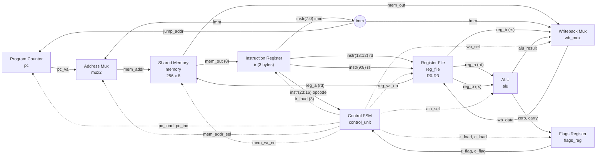
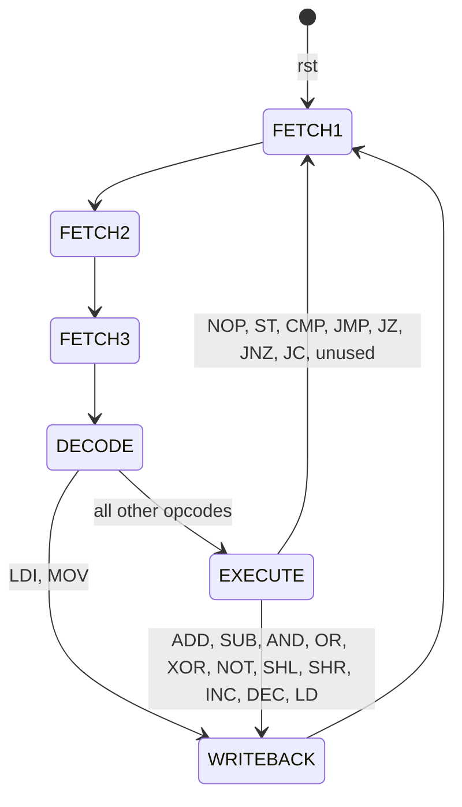
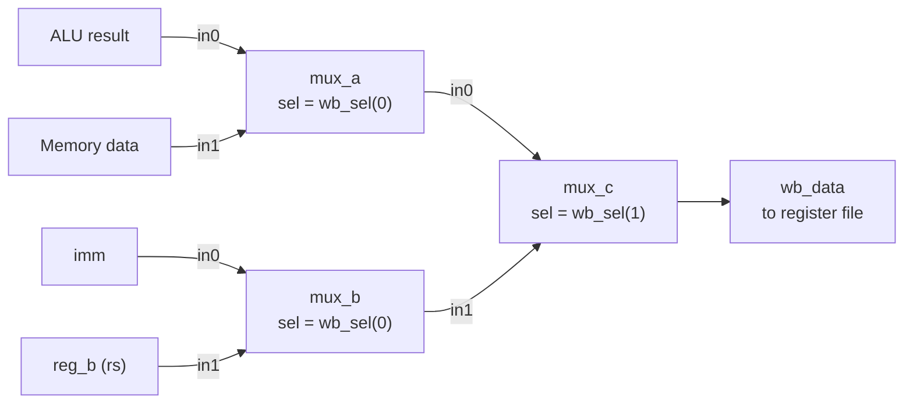
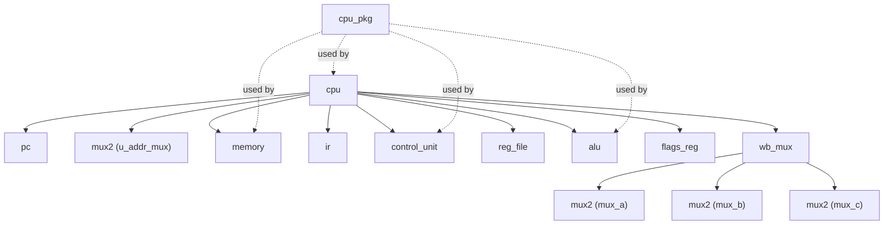

# 8-bit CPU in VHDL — von Neumann version

A simple 8-bit, **multi-cycle**, **von Neumann** CPU written in VHDL and
verified with self-checking testbenches in the Vivado behavioral simulator (XSIM).

This branch starts from the `multicycle` branch (Harvard, 24-bit instructions,
20 instructions) and replaces the separate instruction ROM and data RAM with
**one shared 256 x 8 memory** that holds both the program and the data. Each
24-bit instruction is stored as three bytes and fetched one byte per clock, so
the FSM gains two more fetch states. The instruction set and every other
datapath component are unchanged.

**Status:** RTL complete. All 10 testbenches pass.

> **Branches**
>
> | Branch | Version | Status |
> |---|---|---|
> | `single-cycle` | Single-cycle CPU, 16-bit instructions (tag `v1.0-single-cycle`) | Complete and verified |
> | `multicycle` | Multi-cycle Harvard CPU with an FSM control unit, 24-bit instructions, 20 instructions (tag `v1.1-multicycle-harvard`) | Complete and verified |
> | `von-neumann` | Multi-cycle von Neumann CPU: one shared 256 x 8 memory, byte-wise fetch (tag `v1.2-multicycle-von-neumann`) | Complete and verified (this branch) |

---

## Table of contents

- [Features](#features)
- [Harvard vs von Neumann](#harvard-vs-von-neumann)
- [Memory](#memory)
  - [Memory map](#memory-map)
  - [Instruction layout in memory](#instruction-layout-in-memory)
  - [Synchronous read](#synchronous-read)
- [Architecture](#architecture)
  - [Design decisions](#design-decisions)
  - [Datapath](#datapath)
  - [Control FSM](#control-fsm)
  - [Fetch timing](#fetch-timing)
  - [Cycles per instruction](#cycles-per-instruction)
  - [Writeback multiplexer](#writeback-multiplexer)
- [Instruction set](#instruction-set)
- [ALU](#alu)
- [Control unit](#control-unit)
- [Components](#components)
- [Project structure](#project-structure)
- [Running the simulation](#running-the-simulation)
- [Verification](#verification)
- [Writing your own program](#writing-your-own-program)
- [Limitations](#limitations)
- [Future work](#future-work)

---

## Features

- 8-bit data path, 8-bit program counter (256 byte addresses)
- **Von Neumann architecture:** one 256 x 8 memory for both code and data
- Synchronous-read memory (block-RAM style), read-first on writes
- 24-bit byte-aligned instruction word, 20 instructions (8-bit opcode, room for 256)
- Instructions fetched one byte per clock (FETCH1, FETCH2, FETCH3)
- Four 8-bit general-purpose registers (R0-R3)
- Zero (Z) and Carry (C) flags with independent load enables
- **Multi-cycle execution:** 5 or 6 clocks per instruction, driven by a 6-state FSM
- 24-bit instruction register (IR) with one load enable per byte
- Unused opcodes decode safely as NOP
- Synchronous reset
- Point-to-point datapath with multiplexers (no tri-state bus)
- Self-checking testbenches for every component, plus a full-system testbench that checks the FSM state on every cycle

---

## Harvard vs von Neumann

| | Harvard (`multicycle`) | Von Neumann (this branch) |
|---|---|---|
| Memories | 256 x 24 instruction ROM + 256 x 8 data RAM | One 256 x 8 shared memory |
| Memory read | Asynchronous | Synchronous (one clock latency) |
| Instruction fetch | 1 clock, whole 24-bit word | 3 clocks, one byte each |
| FSM states | 4 | 6 |
| Clocks per instruction | 3 or 4 | 5 or 6 |
| Address source | PC to ROM, imm to RAM | Address mux: PC, or imm for LD/ST |
| IR loading | 24 bits at once | One byte per state (`ir_load(2:0)`) |
| Jump targets | Instruction index | Byte address (3 x instruction index) |
| Code is writable | No | Yes: ST can overwrite instructions |
| Test program, reset to first fetch of the halt `JMP` | 71 cycles | 111 cycles |

Both designs share the ISA, register file, ALU, flags register, writeback mux
and PC. The multi-cycle structure is what makes the shared memory possible:
instruction fetch and data access happen in different states, so they never
need the memory in the same clock.

---

## Memory

`memory.vhd` is a 256 x 8 array with a synchronous write and a synchronous
read. It has no reset, so its contents survive a CPU reset.

### Memory map

| Range | Use |
|---|---|
| `00`-`44` | Test program (23 instructions x 3 bytes) |
| `45`-`EF` | Free (reads as `00` = NOP) |
| `F0`-`FF` | Data area used by LD/ST |

Nothing stops a program from writing into the code area: memory is just bytes.

### Instruction layout in memory

Instruction *n* starts at byte address 3*n*. The opcode is at the lowest
address, so the bytes in memory read in the same order as the hex:

```
Address   Byte   Part of instruction
  00       01    opcode   ─┐
  01       00    rd | rs   ├─ LDI R0, 0F  (01000F)
  02       0F    imm      ─┘
  03       01    opcode   ─┐
  04       10    rd | rs   ├─ LDI R1, 3C  (01103C)
  05       3C    imm      ─┘
```

The program is written as a `prog_data` constant of 24-bit words in
`memory.vhd`. The function `init_mem` splits each word into its three bytes
and returns the initial 256-byte image, which initialises the `mem` signal.

### Synchronous read

`data_out` shows the byte at `addr` **one clock after** the address is
applied, like FPGA block RAM. On a write edge the read returns the old byte
(read-first). The FSM is built around that one-clock latency:

- Each instruction byte is requested in one state and loaded into the IR in the next.
- LD puts imm on the address in EXECUTE; the byte arrives in WRITEBACK, which is where the register file writes it.

---

## Architecture

### Design decisions

| Topic | Decision | Reason |
|---|---|---|
| Memory model | Von Neumann: one memory for code and data | The point of this branch. Fetch and data access are in different FSM states, so one port is enough |
| Memory width | 8 bits | Matches the data width; a 24-bit instruction is three bytes with no wasted bits |
| Memory read | Synchronous, read-first | Matches FPGA block RAM; the FSM absorbs the one-clock latency |
| Address source | `mux2` selecting PC or imm (`mem_addr_sel`) | PC for every fetch; imm only in EXECUTE for LD and ST |
| Fetch | Three states, one byte each, PC +1 in each | Keeps the 24-bit format from the `multicycle` branch unchanged |
| IR | Three byte registers with independent enables | Each byte loads in its own state; independent enables, not a priority chain |
| Byte order | Opcode at the lowest address | Memory dumps read like the instruction hex |
| Jump targets | Byte addresses | The PC addresses bytes; instruction *n* is at 3*n* |
| Interconnect | Point-to-point wiring plus multiplexers | FPGA fabric has no internal tri-state buses |
| Registers | 4 x 8-bit (R0-R3) | Only 2 bits of each 4-bit rd/rs field are wired |
| Opcode decoding | All 8 bits decoded; unused opcodes fall to `others` | Opcodes `14`-`FF` behave as NOP instead of aliasing real instructions |
| Holding registers | IR only | Registers change only in WRITEBACK, so ALU inputs stay stable from DECODE to WRITEBACK |
| Selects vs enables | Selects (`alu_sel`, `wb_sel`) from the opcode only; enables and `mem_addr_sel` from the state | Selects choose *what*; enables decide *when* |
| Reset | Synchronous, highest priority | PC, IR, register file, flags register and FSM (back to FETCH1). The memory has no reset |
| Flags | Zero and Carry only | Enough for JZ, JNZ and JC |
| Carry on SUB | Borrow convention: C = 1 when a < b | `JC` after `CMP a, b` means "jump if a < b" (unsigned) |
| Carry on shifts | C = the bit shifted out | Lets a program test the dropped bit with `JC` |

### Datapath



Solid arrows are data; dotted arrows are control signals from the FSM.

Compared with the `multicycle` branch: the ROM and RAM are replaced by one
`memory`, an address mux chooses between the PC and imm, the memory output
feeds both the IR (one byte at a time) and the writeback mux, and the IR has
three byte enables.

### Control FSM



| State | Memory address | Work done | Enables active |
|---|---|---|---|
| FETCH1 | PC | Request byte 0 (opcode); PC increments | `pc_inc` |
| FETCH2 | PC | Opcode arrives and loads into IR(23:16); request byte 1; PC increments | `pc_inc`, `ir_load = 100` |
| FETCH3 | PC | rd/rs byte loads into IR(15:8); request byte 2; PC increments | `pc_inc`, `ir_load = 010` |
| DECODE | PC | imm byte loads into IR(7:0); next state chosen from the opcode | `ir_load = 001` |
| EXECUTE | imm for LD/ST, otherwise PC | ALU result settles; flags load; ST writes memory; LD requests its byte; jumps load the PC | `z_load`, `c_load`, `mem_wr_en`, `pc_load` (per opcode) |
| WRITEBACK | PC | Result (or LD byte) written to rd | `reg_wr_en` |

### Fetch timing

Because the memory read is synchronous, each byte is loaded one state after
it is requested:

| State | Address on memory | `mem_out` during this state | IR loads at the end |
|---|---|---|---|
| FETCH1 | PC | (previous) | — |
| FETCH2 | PC + 1 | opcode | IR(23:16) |
| FETCH3 | PC + 2 | rd/rs | IR(15:8) |
| DECODE | PC + 3 | imm | IR(7:0) |

The opcode is in the IR from FETCH3, so DECODE can choose the next state; rd/rs
are ready in DECODE; imm is ready from EXECUTE, which is the first state that
uses it. Until then the IR holds a mix of the new and old instruction's bytes;
nothing reads the stale bytes.

### Cycles per instruction

| Instructions | Path | Clocks |
|---|---|---|
| NOP, ST, CMP, JMP, JZ, JNZ, JC, unused opcodes | FETCH1 → FETCH2 → FETCH3 → DECODE → EXECUTE | 5 |
| LDI, MOV | FETCH1 → FETCH2 → FETCH3 → DECODE → WRITEBACK | 5 |
| ADD, SUB, AND, OR, XOR, NOT, SHL, SHR, INC, DEC, LD | FETCH1 → FETCH2 → FETCH3 → DECODE → EXECUTE → WRITEBACK | 6 |

### Writeback multiplexer

`wb_mux` is a 4-to-1 multiplexer built from three 2-to-1 multiplexers (`mux2`):



| wb_sel | Constant | Source | Used by |
|---|---|---|---|
| 00 | `WB_ALU` | ALU result | ADD, SUB, AND, OR, XOR, NOT, SHL, SHR, INC, DEC |
| 01 | `WB_RAM` | Shared memory | LD |
| 10 | `WB_IMM` | Immediate | LDI |
| 11 | `WB_REG` | rs register | MOV |

---

## Instruction set

Unchanged from the `multicycle` branch, except that jump targets and LD/ST
addresses are byte addresses in the shared memory.

### Instruction format

```
 23            16 15    12 11     8 7             0
+----------------+--------+--------+---------------+
|     opcode     |   rd   |   rs   |      imm      |
+----------------+--------+--------+---------------+
      8 bits       4 bits   4 bits      8 bits
   byte at 3n      byte at 3n+1       byte at 3n+2
```

Unused fields are 0. Only R0-R3 exist, so the upper 2 bits of rd and rs must
be 0. In hexadecimal: digits 1-2 are the opcode, digit 3 is rd, digit 4 is rs,
digits 5-6 are imm.

### Instructions

| Opcode | Mnemonic | Operation | Flags |
|---|---|---|---|
| 00 | `NOP` | No operation | - |
| 01 | `LDI rd, imm` | rd = imm | - |
| 02 | `MOV rd, rs` | rd = rs | - |
| 03 | `LD rd, addr` | rd = MEM[addr] | - |
| 04 | `ST rd, addr` | MEM[addr] = rd | - |
| 05 | `ADD rd, rs` | rd = rd + rs | Z, C |
| 06 | `SUB rd, rs` | rd = rd - rs | Z, C |
| 07 | `AND rd, rs` | rd = rd and rs | Z |
| 08 | `OR rd, rs` | rd = rd or rs | Z |
| 09 | `XOR rd, rs` | rd = rd xor rs | Z |
| 0A | `NOT rd` | rd = not rd | Z |
| 0B | `CMP rd, rs` | Compute rd - rs, set flags, discard result | Z, C |
| 0C | `JMP addr` | PC = addr | - |
| 0D | `JZ addr` | PC = addr if Z = 1 | - |
| 0E | `JNZ addr` | PC = addr if Z = 0 | - |
| 0F | `JC addr` | PC = addr if C = 1 | - |
| 10 | `SHL rd` | rd = rd shifted left one bit, 0 into bit 0 | Z, C |
| 11 | `SHR rd` | rd = rd shifted right one bit (logical), 0 into bit 7 | Z, C |
| 12 | `INC rd` | rd = rd + 1 | Z, C |
| 13 | `DEC rd` | rd = rd - 1 | Z, C |
| 14-FF | (unused) | Behaves as NOP | - |

`JMP` to its own address acts as a halt (the FSM keeps cycling FETCH1 to EXECUTE on it).

### Flags

| Flag | Set when | Updated by | Read by |
|---|---|---|---|
| Z (zero) | ALU result is 00 | ADD, SUB, CMP, AND, OR, XOR, NOT, SHL, SHR, INC, DEC | JZ, JNZ |
| C (carry) | See the table below | ADD, SUB, CMP, SHL, SHR, INC, DEC | JC |

| Instruction | C = 1 when |
|---|---|
| ADD | The sum overflows past FF |
| SUB, CMP | Borrow: rd < rs |
| SHL | Bit 7 of rd was 1 (shifted out) |
| SHR | Bit 0 of rd was 1 (shifted out) |
| INC | rd was FF (wraps to 00) |
| DEC | rd was 00 (borrow, wraps to FF) |

Logic operations update Z but keep C, so the flags register has a separate load enable per flag.

---

## ALU

`alu.vhd` is combinational and unchanged from the `multicycle` branch.

| Code | Constant | Result | Carry |
|---|---|---|---|
| 0000 | `ALU_ADD` | a + b | Overflow |
| 0001 | `ALU_SUB` | a - b | Borrow |
| 0010 | `ALU_AND` | a and b | 0 |
| 0011 | `ALU_OR` | a or b | 0 |
| 0100 | `ALU_XOR` | a xor b | 0 |
| 0101 | `ALU_NOT` | not a | 0 |
| 0110 | `ALU_SHL` | a(6:0) & '0' | a(7) |
| 0111 | `ALU_SHR` | '0' & a(7:1) | a(0) |
| 1000 | `ALU_INC` | a + 1 | Overflow |
| 1001 | `ALU_DEC` | a - 1 | Borrow |
| 1010-1111 | (spare) | 00 | 0 |

---

## Control unit

`control_unit.vhd` is a three-process FSM:

| Process | Type | Contents |
|---|---|---|
| `state_reg` | Clocked | Synchronous reset to FETCH1, otherwise `state <= next_state` |
| `next_state_logic` | Combinational | Transition table below |
| `output_logic` | Combinational | Defaults, then selects from the opcode, then enables from the state |

The state type `state_t` and the address-select constants `ADDR_PC` / `ADDR_IMM` are declared in `cpu_pkg`.

### Next state

| Current | Condition | Next |
|---|---|---|
| FETCH1 | always | FETCH2 |
| FETCH2 | always | FETCH3 |
| FETCH3 | always | DECODE |
| DECODE | LDI, MOV | WRITEBACK |
| DECODE | otherwise | EXECUTE |
| EXECUTE | ADD, SUB, AND, OR, XOR, NOT, SHL, SHR, INC, DEC, LD | WRITEBACK |
| EXECUTE | otherwise | FETCH1 |
| WRITEBACK | always | FETCH1 |

### Selects (from the opcode, in every state)

| Opcode | alu_sel | wb_sel |
|---|---|---|
| ADD | ADD | ALU |
| SUB, CMP | SUB | ALU |
| AND / OR / XOR / NOT | AND / OR / XOR / NOT | ALU |
| SHL / SHR / INC / DEC | SHL / SHR / INC / DEC | ALU |
| LDI | ADD | IMM |
| MOV | ADD | REG |
| LD | ADD | RAM |
| others | ADD | ALU |

### Enables and address select (by state)

| State | Opcode | Outputs = 1 (or non-default) |
|---|---|---|
| FETCH1 | any | `pc_inc` |
| FETCH2 | any | `pc_inc`, `ir_load = 100` |
| FETCH3 | any | `pc_inc`, `ir_load = 010` |
| DECODE | any | `ir_load = 001` |
| EXECUTE | ADD, SUB, CMP, SHL, SHR, INC, DEC | `z_load`, `c_load` |
| EXECUTE | AND, OR, XOR, NOT | `z_load` |
| EXECUTE | LD | `mem_addr_sel = ADDR_IMM` |
| EXECUTE | ST | `mem_wr_en`, `mem_addr_sel = ADDR_IMM` |
| EXECUTE | JMP | `pc_load` |
| EXECUTE | JZ / JNZ / JC | `pc_load` = Z / not Z / C |
| EXECUTE | NOP, unused | none |
| WRITEBACK | any | `reg_wr_en` |

`mem_addr_sel` defaults to `ADDR_PC`, so every fetch reads from the PC.

---

## Components

| Entity | File | Type | Description |
|---|---|---|---|
| `cpu_pkg` | `cpu_pkg.vhd` | Package | 8-bit `OP_*`, 4-bit `ALU_*`, 4-bit `REG0`-`REG3`, 2-bit `WB_*`, `ADDR_PC`/`ADDR_IMM`, and the FSM state type `state_t` |
| `cpu` | `cpu.vhd` | Structural | Top level; instantiates and wires every component. Exposes debug outputs |
| `pc` | `pc.vhd` | Sequential | 8-bit program counter. Priority: reset > load > increment > hold |
| `memory` | `memory.vhd` | Sequential | **New.** 256 x 8 shared memory, synchronous read-first, initialised with the program, no reset |
| `ir` | `ir.vhd` | Sequential | **Changed.** 24-bit instruction register loaded one byte at a time |
| `control_unit` | `control_unit.vhd` | Sequential (FSM) | **Changed.** 6-state control FSM |
| `reg_file` | `reg_file.vhd` | Sequential | 4 x 8-bit registers, two asynchronous read ports, one synchronous write port |
| `alu` | `alu.vhd` | Combinational | ADD, SUB, AND, OR, XOR, NOT, SHL, SHR, INC, DEC with zero and carry outputs |
| `flags_reg` | `flags_reg.vhd` | Sequential | Stores Z and C with independent load enables |
| `wb_mux` | `wb_mux.vhd` | Structural | 4-to-1 writeback multiplexer built from three `mux2` |
| `mux2` | `mux2.vhd` | Combinational | 8-bit 2-to-1 multiplexer (gate-level); also used as the memory address mux |

`instr_rom` and `data_ram` from the `multicycle` branch are not used here.

### Component hierarchy



### Debug outputs

| Port | Width | Shows |
|---|---|---|
| `pc_dbg` | 8 | Program counter (a byte address; it advances in each FETCH state) |
| `instr_dbg` | 24 | Instruction register (complete from EXECUTE/WRITEBACK) |
| `reg_a_dbg` | 8 | Value of the rd register of the instruction in the IR |
| `z_dbg` | 1 | Stored zero flag |
| `c_dbg` | 1 | Stored carry flag |
| `state_dbg` | `state_t` | Current FSM state |

---

## Project structure

```
8-bit-cpu/
├── rtl/
│   ├── cpu_pkg.vhd
│   ├── cpu.vhd
│   ├── pc.vhd
│   ├── memory.vhd
│   ├── ir.vhd
│   ├── control_unit.vhd
│   ├── reg_file.vhd
│   ├── alu.vhd
│   ├── flags_reg.vhd
│   ├── wb_mux.vhd
│   └── mux2.vhd
├── tb/
│   ├── tb_cpu.vhd
│   ├── tb_pc.vhd
│   ├── tb_memory.vhd
│   ├── tb_ir.vhd
│   ├── tb_control_unit.vhd
│   ├── tb_reg_file.vhd
│   ├── tb_alu.vhd
│   ├── tb_flags_reg.vhd
│   ├── tb_wb_mux.vhd
│   └── tb_mux2.vhd
└── README.md
```

### Coding conventions

- `std_logic_vector` at ports, `numeric_std` for arithmetic
- Architectures named `rtl` (behavioural), `structural` (instantiation only) or `sim` (testbenches)
- Synchronous active-high reset
- Instances prefixed `u_` in the top level
- Every combinational process assigns defaults before any branching, so no latches are inferred
- Every `case` on the opcode has a `when others` branch, so all 256 opcodes are covered
- Independent load enables are separate `if` statements, not an `elsif` chain
- FSM states as an enumerated type, so waveforms and failure messages show state names

---

## Running the simulation

1. Create a new RTL project in Vivado.
2. **Add design sources:** every file in `rtl/`.
3. **Add simulation sources:** every file in `tb/`.
4. **Compile order:** `cpu_pkg.vhd` must compile first (it is used by `alu`, `control_unit`, `memory`, `cpu` and several testbenches). Right-click in Sources → **Hierarchy Update** → **Automatic Update and Compile Order**, then check the **Compile Order** tab.
5. **Run time:** the default 1000 ns is too short for `tb_control_unit` and `tb_cpu`. Set **Settings → Simulation → Simulation → `xsim.simulate.runtime`** to `2000ns`.
6. Right-click the testbench to run → **Set as Top**.
7. **Run Simulation** → **Run Behavioral Simulation**.
8. Check the Tcl Console for `Note: all tests completed and passed`.

If XSIM reports that a unit "needs to be re-saved since 'xil_defaultlib.cpu_pkg' changed", use **Simulation → Reset Behavioral Simulation** and run again.

A failing run stops at the first failed check, naming the test and signal, for example:

```
Failure: cycle 59 failed: reg_a_dbg
Failure: test 4 LD execute failed: mem_addr_sel
Failure: test 5 ST fetch2 failed: state is S_FETCH1
```

---

## Verification

Every testbench is self-checking (`assert ... severity failure`). The clocked FSM and system testbenches use a `check` procedure so each cycle is one line that compares every output.

### Testbenches

| Testbench | Checks | What is covered | Passes at |
|---|---|---|---|
| `tb_mux2` | 10 | Both select values over several bit patterns | 100 ns |
| `tb_wb_mux` | 6 | All four writeback paths | 60 ns |
| `tb_alu` | 32 | Every operation including SHL/SHR/INC/DEC, carry/borrow and wrap edge cases, spare codes | 320 ns |
| `tb_memory` | 15 | Program bytes from `init_mem`, empty and top addresses, read-first writes, writes to data and code, blocked write, read latency | 150 ns |
| `tb_pc` | 11 | Reset, increment, hold, load priority, wrap | 120 ns |
| `tb_ir` | 11 | Reset, each byte load alone, full assembly, hold, multi-byte loads, reset priority, load timing | 110 ns |
| `tb_flags_reg` | 9 | Independent flag loads, hold, reset priority, timing | 90 ns |
| `tb_reg_file` | 14 | Every register, both ports, reset priority, timing | 140 ns |
| `tb_control_unit` | 137 | Every opcode through its full state sequence, including IR byte loads and the memory address select; each conditional jump both ways; an unused opcode as NOP; reset mid-instruction | 1370 ns |
| `tb_cpu` | 126 cycles | Full program, FSM state and all debug outputs every cycle | 1260 ns |

In `tb_control_unit` the opcode changes only during FETCH1. `mem_addr_sel` is checked in every state, so a fetch from the wrong address would be caught. The unused-opcode test (`FF`) runs with both flags set, proving an unknown opcode can never trigger a jump.

`tb_ir` loads two and three bytes at once (`111`, `101`), which would fail if the byte enables were a priority chain.

### System test program

| Instr | Addr | Instruction | Bytes | Effect |
|---|---|---|---|---|
| 0 | `00` | `LDI R0, 0F` | `01 00 0F` | R0 = 0F |
| 1 | `03` | `LDI R1, 3C` | `01 10 3C` | R1 = 3C |
| 2 | `06` | `MOV R2, R1` | `02 21 00` | R2 = 3C |
| 3 | `09` | `ADD R2, R0` | `05 20 00` | R2 = 4B |
| 4 | `0C` | `AND R2, R1` | `07 21 00` | R2 = 08 |
| 5 | `0F` | `OR R2, R0` | `08 20 00` | R2 = 0F |
| 6 | `12` | `XOR R2, R0` | `09 20 00` | R2 = 00, Z = 1 |
| 7 | `15` | `JZ 1B` | `0D 00 1B` | Taken |
| 8 | `18` | `LDI R3, FF` | `01 30 FF` | Must be skipped |
| 9 | `1B` | `NOT R2` | `0A 20 00` | R2 = FF |
| 10 | `1E` | `ST R2, F0` | `04 20 F0` | MEM[F0] = FF |
| 11 | `21` | `LD R3, F0` | `03 30 F0` | R3 = FF |
| 12 | `24` | `SUB R0, R1` | `06 01 00` | R0 = D3, C = 1 (borrow) |
| 13 | `27` | `JC 2D` | `0F 00 2D` | Taken |
| 14 | `2A` | `LDI R3, 00` | `01 30 00` | Must be skipped |
| 15 | `2D` | `CMP R3, R2` | `0B 32 00` | Z = 1, C = 0, R3 unchanged |
| 16 | `30` | `JNZ 42` | `0E 00 42` | Not taken |
| 17 | `33` | `NOP` | `00 00 00` | |
| 18 | `36` | `INC R2` | `12 20 00` | R2 = 00 (FF wraps), Z = 1, C = 1 |
| 19 | `39` | `DEC R1` | `13 10 00` | R1 = 3B, Z = 0, C = 0 |
| 20 | `3C` | `SHL R0` | `10 00 00` | R0 = A6, C = 1 (bit 7 out) |
| 21 | `3F` | `SHR R0` | `11 00 00` | R0 = 53, C = 0 (bit 0 out) |
| 22 | `42` | `JMP 42` | `0C 00 42` | Halt |

### Expected trace

Checked by `tb_cpu` at each falling edge. Values are hexadecimal.

How to read it:
- **The PC increments in each FETCH state**, so by DECODE it already points at the next instruction (instruction address + 3).
- **The IR fills one byte per state.** During FETCH2, FETCH3 and DECODE it holds a mix of the new and the previous instruction's bytes; it is complete from EXECUTE (or WRITEBACK for LDI/MOV). Cycle 0 shows `000000` from reset.
- **Results appear one state later**: a WRITEBACK's value is visible at the next FETCH1; flags loaded in EXECUTE are visible from the next state.
- **The halt** cycles FETCH1 to EXECUTE on `JMP 42`, so the PC runs 42, 43, 44, 45, 45 and jumps back.

| Cycle | State | PC | IR | Instruction being executed | reg_a | Z | C |
|---|---|---|---|---|---|---|---|
| 0 | FETCH1 | 00 | `000000` | LDI R0, 0F | 00 | 0 | 0 |
| 1 | FETCH2 | 01 | `000000` | LDI R0, 0F | 00 | 0 | 0 |
| 2 | FETCH3 | 02 | `010000` | LDI R0, 0F | 00 | 0 | 0 |
| 3 | DECODE | 03 | `010000` | LDI R0, 0F | 00 | 0 | 0 |
| 4 | WRITEBACK | 03 | `01000F` | LDI R0, 0F | 00 | 0 | 0 |
| 5 | FETCH1 | 03 | `01000F` | LDI R1, 3C | 0F | 0 | 0 |
| 6 | FETCH2 | 04 | `01000F` | LDI R1, 3C | 0F | 0 | 0 |
| 7 | FETCH3 | 05 | `01000F` | LDI R1, 3C | 0F | 0 | 0 |
| 8 | DECODE | 06 | `01100F` | LDI R1, 3C | 00 | 0 | 0 |
| 9 | WRITEBACK | 06 | `01103C` | LDI R1, 3C | 00 | 0 | 0 |
| 10 | FETCH1 | 06 | `01103C` | MOV R2, R1 | 3C | 0 | 0 |
| 11 | FETCH2 | 07 | `01103C` | MOV R2, R1 | 3C | 0 | 0 |
| 12 | FETCH3 | 08 | `02103C` | MOV R2, R1 | 3C | 0 | 0 |
| 13 | DECODE | 09 | `02213C` | MOV R2, R1 | 00 | 0 | 0 |
| 14 | WRITEBACK | 09 | `022100` | MOV R2, R1 | 00 | 0 | 0 |
| 15 | FETCH1 | 09 | `022100` | ADD R2, R0 | 3C | 0 | 0 |
| 16 | FETCH2 | 0A | `022100` | ADD R2, R0 | 3C | 0 | 0 |
| 17 | FETCH3 | 0B | `052100` | ADD R2, R0 | 3C | 0 | 0 |
| 18 | DECODE | 0C | `052000` | ADD R2, R0 | 3C | 0 | 0 |
| 19 | EXECUTE | 0C | `052000` | ADD R2, R0 | 3C | 0 | 0 |
| 20 | WRITEBACK | 0C | `052000` | ADD R2, R0 | 3C | 0 | 0 |
| 21 | FETCH1 | 0C | `052000` | AND R2, R1 | 4B | 0 | 0 |
| 22 | FETCH2 | 0D | `052000` | AND R2, R1 | 4B | 0 | 0 |
| 23 | FETCH3 | 0E | `072000` | AND R2, R1 | 4B | 0 | 0 |
| 24 | DECODE | 0F | `072100` | AND R2, R1 | 4B | 0 | 0 |
| 25 | EXECUTE | 0F | `072100` | AND R2, R1 | 4B | 0 | 0 |
| 26 | WRITEBACK | 0F | `072100` | AND R2, R1 | 4B | 0 | 0 |
| 27 | FETCH1 | 0F | `072100` | OR R2, R0 | 08 | 0 | 0 |
| 28 | FETCH2 | 10 | `072100` | OR R2, R0 | 08 | 0 | 0 |
| 29 | FETCH3 | 11 | `082100` | OR R2, R0 | 08 | 0 | 0 |
| 30 | DECODE | 12 | `082000` | OR R2, R0 | 08 | 0 | 0 |
| 31 | EXECUTE | 12 | `082000` | OR R2, R0 | 08 | 0 | 0 |
| 32 | WRITEBACK | 12 | `082000` | OR R2, R0 | 08 | 0 | 0 |
| 33 | FETCH1 | 12 | `082000` | XOR R2, R0 | 0F | 0 | 0 |
| 34 | FETCH2 | 13 | `082000` | XOR R2, R0 | 0F | 0 | 0 |
| 35 | FETCH3 | 14 | `092000` | XOR R2, R0 | 0F | 0 | 0 |
| 36 | DECODE | 15 | `092000` | XOR R2, R0 | 0F | 0 | 0 |
| 37 | EXECUTE | 15 | `092000` | XOR R2, R0 | 0F | 0 | 0 |
| 38 | WRITEBACK | 15 | `092000` | XOR R2, R0 | 0F | 1 | 0 |
| 39 | FETCH1 | 15 | `092000` | JZ 1B | 00 | 1 | 0 |
| 40 | FETCH2 | 16 | `092000` | JZ 1B | 00 | 1 | 0 |
| 41 | FETCH3 | 17 | `0D2000` | JZ 1B | 00 | 1 | 0 |
| 42 | DECODE | 18 | `0D0000` | JZ 1B | 0F | 1 | 0 |
| 43 | EXECUTE | 18 | `0D001B` | JZ 1B | 0F | 1 | 0 |
| 44 | FETCH1 | 1B | `0D001B` | NOT R2 | 0F | 1 | 0 |
| 45 | FETCH2 | 1C | `0D001B` | NOT R2 | 0F | 1 | 0 |
| 46 | FETCH3 | 1D | `0A001B` | NOT R2 | 0F | 1 | 0 |
| 47 | DECODE | 1E | `0A201B` | NOT R2 | 00 | 1 | 0 |
| 48 | EXECUTE | 1E | `0A2000` | NOT R2 | 00 | 1 | 0 |
| 49 | WRITEBACK | 1E | `0A2000` | NOT R2 | 00 | 0 | 0 |
| 50 | FETCH1 | 1E | `0A2000` | ST R2, F0 | FF | 0 | 0 |
| 51 | FETCH2 | 1F | `0A2000` | ST R2, F0 | FF | 0 | 0 |
| 52 | FETCH3 | 20 | `042000` | ST R2, F0 | FF | 0 | 0 |
| 53 | DECODE | 21 | `042000` | ST R2, F0 | FF | 0 | 0 |
| 54 | EXECUTE | 21 | `0420F0` | ST R2, F0 | FF | 0 | 0 |
| 55 | FETCH1 | 21 | `0420F0` | LD R3, F0 | FF | 0 | 0 |
| 56 | FETCH2 | 22 | `0420F0` | LD R3, F0 | FF | 0 | 0 |
| 57 | FETCH3 | 23 | `0320F0` | LD R3, F0 | FF | 0 | 0 |
| 58 | DECODE | 24 | `0330F0` | LD R3, F0 | 00 | 0 | 0 |
| 59 | EXECUTE | 24 | `0330F0` | LD R3, F0 | 00 | 0 | 0 |
| 60 | WRITEBACK | 24 | `0330F0` | LD R3, F0 | 00 | 0 | 0 |
| 61 | FETCH1 | 24 | `0330F0` | SUB R0, R1 | FF | 0 | 0 |
| 62 | FETCH2 | 25 | `0330F0` | SUB R0, R1 | FF | 0 | 0 |
| 63 | FETCH3 | 26 | `0630F0` | SUB R0, R1 | FF | 0 | 0 |
| 64 | DECODE | 27 | `0601F0` | SUB R0, R1 | 0F | 0 | 0 |
| 65 | EXECUTE | 27 | `060100` | SUB R0, R1 | 0F | 0 | 0 |
| 66 | WRITEBACK | 27 | `060100` | SUB R0, R1 | 0F | 0 | 1 |
| 67 | FETCH1 | 27 | `060100` | JC 2D | D3 | 0 | 1 |
| 68 | FETCH2 | 28 | `060100` | JC 2D | D3 | 0 | 1 |
| 69 | FETCH3 | 29 | `0F0100` | JC 2D | D3 | 0 | 1 |
| 70 | DECODE | 2A | `0F0000` | JC 2D | D3 | 0 | 1 |
| 71 | EXECUTE | 2A | `0F002D` | JC 2D | D3 | 0 | 1 |
| 72 | FETCH1 | 2D | `0F002D` | CMP R3, R2 | D3 | 0 | 1 |
| 73 | FETCH2 | 2E | `0F002D` | CMP R3, R2 | D3 | 0 | 1 |
| 74 | FETCH3 | 2F | `0B002D` | CMP R3, R2 | D3 | 0 | 1 |
| 75 | DECODE | 30 | `0B322D` | CMP R3, R2 | FF | 0 | 1 |
| 76 | EXECUTE | 30 | `0B3200` | CMP R3, R2 | FF | 0 | 1 |
| 77 | FETCH1 | 30 | `0B3200` | JNZ 42 | FF | 1 | 0 |
| 78 | FETCH2 | 31 | `0B3200` | JNZ 42 | FF | 1 | 0 |
| 79 | FETCH3 | 32 | `0E3200` | JNZ 42 | FF | 1 | 0 |
| 80 | DECODE | 33 | `0E0000` | JNZ 42 | D3 | 1 | 0 |
| 81 | EXECUTE | 33 | `0E0042` | JNZ 42 | D3 | 1 | 0 |
| 82 | FETCH1 | 33 | `0E0042` | NOP | D3 | 1 | 0 |
| 83 | FETCH2 | 34 | `0E0042` | NOP | D3 | 1 | 0 |
| 84 | FETCH3 | 35 | `000042` | NOP | D3 | 1 | 0 |
| 85 | DECODE | 36 | `000042` | NOP | D3 | 1 | 0 |
| 86 | EXECUTE | 36 | `000000` | NOP | D3 | 1 | 0 |
| 87 | FETCH1 | 36 | `000000` | INC R2 | D3 | 1 | 0 |
| 88 | FETCH2 | 37 | `000000` | INC R2 | D3 | 1 | 0 |
| 89 | FETCH3 | 38 | `120000` | INC R2 | D3 | 1 | 0 |
| 90 | DECODE | 39 | `122000` | INC R2 | FF | 1 | 0 |
| 91 | EXECUTE | 39 | `122000` | INC R2 | FF | 1 | 0 |
| 92 | WRITEBACK | 39 | `122000` | INC R2 | FF | 1 | 1 |
| 93 | FETCH1 | 39 | `122000` | DEC R1 | 00 | 1 | 1 |
| 94 | FETCH2 | 3A | `122000` | DEC R1 | 00 | 1 | 1 |
| 95 | FETCH3 | 3B | `132000` | DEC R1 | 00 | 1 | 1 |
| 96 | DECODE | 3C | `131000` | DEC R1 | 3C | 1 | 1 |
| 97 | EXECUTE | 3C | `131000` | DEC R1 | 3C | 1 | 1 |
| 98 | WRITEBACK | 3C | `131000` | DEC R1 | 3C | 0 | 0 |
| 99 | FETCH1 | 3C | `131000` | SHL R0 | 3B | 0 | 0 |
| 100 | FETCH2 | 3D | `131000` | SHL R0 | 3B | 0 | 0 |
| 101 | FETCH3 | 3E | `101000` | SHL R0 | 3B | 0 | 0 |
| 102 | DECODE | 3F | `100000` | SHL R0 | D3 | 0 | 0 |
| 103 | EXECUTE | 3F | `100000` | SHL R0 | D3 | 0 | 0 |
| 104 | WRITEBACK | 3F | `100000` | SHL R0 | D3 | 0 | 1 |
| 105 | FETCH1 | 3F | `100000` | SHR R0 | A6 | 0 | 1 |
| 106 | FETCH2 | 40 | `100000` | SHR R0 | A6 | 0 | 1 |
| 107 | FETCH3 | 41 | `110000` | SHR R0 | A6 | 0 | 1 |
| 108 | DECODE | 42 | `110000` | SHR R0 | A6 | 0 | 1 |
| 109 | EXECUTE | 42 | `110000` | SHR R0 | A6 | 0 | 1 |
| 110 | WRITEBACK | 42 | `110000` | SHR R0 | A6 | 0 | 0 |
| 111 | FETCH1 | 42 | `110000` | JMP 42 | 53 | 0 | 0 |
| 112 | FETCH2 | 43 | `110000` | JMP 42 | 53 | 0 | 0 |
| 113 | FETCH3 | 44 | `0C0000` | JMP 42 | 53 | 0 | 0 |
| 114 | DECODE | 45 | `0C0000` | JMP 42 | 53 | 0 | 0 |
| 115 | EXECUTE | 45 | `0C0042` | JMP 42 | 53 | 0 | 0 |
| 116 | FETCH1 | 42 | `0C0042` | JMP 42 | 53 | 0 | 0 |
| 117 | FETCH2 | 43 | `0C0042` | JMP 42 | 53 | 0 | 0 |
| 118 | FETCH3 | 44 | `0C0042` | JMP 42 | 53 | 0 | 0 |
| 119 | DECODE | 45 | `0C0042` | JMP 42 | 53 | 0 | 0 |
| 120 | EXECUTE | 45 | `0C0042` | JMP 42 | 53 | 0 | 0 |
| 121 | FETCH1 | 42 | `0C0042` | JMP 42 | 53 | 0 | 0 |
| 122 | FETCH2 | 43 | `0C0042` | JMP 42 | 53 | 0 | 0 |
| 123 | FETCH3 | 44 | `0C0042` | JMP 42 | 53 | 0 | 0 |
| 124 | DECODE | 45 | `0C0042` | JMP 42 | 53 | 0 | 0 |
| 125 | EXECUTE | 45 | `0C0042` | JMP 42 | 53 | 0 | 0 |

Key checks: register results at the FETCH1 after each WRITEBACK (cycles 5, 10, 15, 21...), the jumps landing at 1B (cycle 44) and 2D (cycle 72), R3 still 00 in the LD's DECODE at cycle 58 (the skipped LDI never ran) and FF at cycle 61 (the LD read back the byte the ST wrote to F0), JNZ falling through to 33 (cycle 82), INC wrapping FF to 00 with Z and C set (cycles 92-93), SHL moving bit 7 into C (cycles 104-105), and the halt loop from cycle 111.

---

## Writing your own program

Programs live in the `prog_data` constant in `memory.vhd`, one 24-bit word per instruction, built from `cpu_pkg` constants as `opcode & rd & rs & imm`. `init_mem` splits them into bytes:

```vhdl
constant prog_data : prog_type := (
    0 => OP_LDI & REG0 & REG0 & x"05",   -- LDI R0, 05   counter
    1 => OP_DEC & REG0 & REG0 & x"00",   -- DEC R0
    2 => OP_JNZ & REG0 & REG0 & x"03",   -- JNZ 03       loop until R0 = 0
    3 => OP_JMP & REG0 & REG0 & x"09"    -- JMP 09       halt
);
```

- **Jump targets are byte addresses:** instruction *n* starts at 3 x *n*. In the example, `DEC` is instruction 1 at `03` and `JMP` is instruction 3 at `09`.
- Put `REG0` and `x"00"` in unused fields.
- Keep code below `F0` (at most 80 instructions) and put data at `F0`-`FF`, or move the data area and update the LD/ST addresses.
- End with a `JMP` to its own address.
- After changing the program, update `tb_memory.vhd` and the expected trace in `tb_cpu.vhd`. Remember each instruction takes 5 or 6 cycles.

---

## Limitations

- No stack, subroutine calls or interrupts.
- No rotate or arithmetic-shift instructions; shifts are one bit at a time.
- Only direct addressing for LD/ST.
- Unsigned arithmetic only: no overflow or negative flag.
- Only 4 registers, although the instruction format has room for 16.
- Code and data share 256 bytes, and nothing protects the code from ST.
- Every instruction fetches all three bytes, even when it does not use rd/rs or imm.
- The program is fixed in `memory.vhd`, and memory is not reloaded by a CPU reset.

---

## Future work

- **Load the memory from a text file** at simulation start.
- **Stack pointer** with PUSH, POP, CALL and RET.
